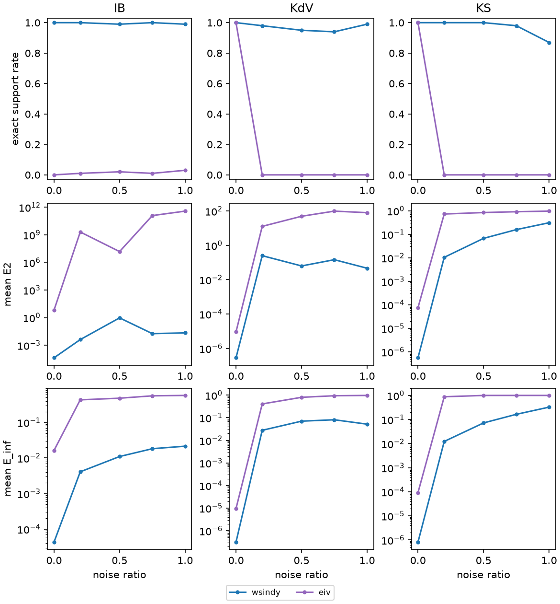

# WSINDy benchmark

Methods are defined in `run.py` (METHODS). TPR = TP/(TP+FN+FP); Exact = exact-support rate; E_inf = max relative error over true terms; E2 = relative coefficient L2 error; mean ± sample SD over trials, failures included. Seconds cover estimation, weak system and regression. Mean lambda / r: mean selected LASSO penalty, or best-subset sparsity bound r, per equation.

## Seeds

Noise seeds (trials) per noise level; noise ratios 0, 0.2, 0.5, 0.75, 1. Trial i uses the same seed for every method (pdes.trial_seed, root seed 0), so methods are compared on identical observations. At noise ratio 0 all trials coincide.

| Method | IB | KdV | KS |
| :--- | ---: | ---: | ---: |
| wsindy | 100 | 100 | 100 |
| eiv | 100 | 100 | 100 |

## Summary

Exact-support rate (%) · mean E_inf, per noise ratio.

| PDE | Method | 0 | 0.2 | 0.5 | 0.75 | 1 |
| :--- | :--- | ---: | ---: | ---: | ---: | ---: |
| IB | wsindy | 100 · 4.3e-05 | 100 · 0.0041 | 99 · 0.011 | 100 · 0.018 | 99 · 0.021 |
| IB | eiv | 0 · 0.016 | 1 · 0.43 | 2 · 0.48 | 1 · 0.56 | 3 · 0.57 |
| KdV | wsindy | 100 · 3.1e-07 | 98 · 0.028 | 95 · 0.071 | 94 · 0.081 | 99 · 0.052 |
| KdV | eiv | 100 · 9.6e-06 | 0 · 0.41 | 0 · 0.8 | 0 · 0.94 | 0 · 0.97 |
| KS | wsindy | 100 · 8.2e-07 | 100 · 0.012 | 100 · 0.072 | 98 · 0.16 | 87 · 0.33 |
| KS | eiv | 100 · 9.3e-05 | 0 · 0.88 | 0 · 1 | 0 · 1 | 0 · 1 |

## IB

`u_t = -0.5 (u^2)_x`  

| Data U | X (K x J) | Y (K x E) | beta (J x E) | True nonzeros |
| :--- | :--- | :--- | :--- | :--- |
| 256 x 256 grid; components u | 784 x 43 | 784 x 1 | 43 x 1 | 1 of 43 (u_t: 1) |

K = weak equations (test-function centers), J = dictionary terms, E = equations. Test functions `Tests(m=(60, 60), p=(7, 7), s=(5, 5), shape='poly', tau=1e-10, tau_hat=2.0)`.

### Noise ratio 0

| Method | Trials | Exact | TPR | E_inf | E2 | Mean seconds | Mean lambda / r |
| :--- | ---: | ---: | ---: | ---: | ---: | ---: | :--- |
| wsindy | 100 | 100.0% | 1 ± 0 | 4.30846e-05 ± 0 | 4.30846e-05 ± 0 | 0.0252 | — |
| eiv | 100 | 0.0% | 0.333333 ± 1.12e-16 | 0.0163045 ± 3.49e-18 | 6.51529 ± 2.68e-15 | 8.77 | — |

### Noise ratio 0.2

| Method | Trials | Exact | TPR | E_inf | E2 | Mean seconds | Mean lambda / r |
| :--- | ---: | ---: | ---: | ---: | ---: | ---: | :--- |
| wsindy | 100 | 100.0% | 1 ± 0 | 0.00408295 ± 0.00318 | 0.00408295 ± 0.00318 | 0.0258 | — |
| eiv | 100 | 1.0% | 0.27023 ± 0.15 | 0.431558 ± 0.288 | 2.02694e+09 ± 2e+10 | 7.92 | — |

### Noise ratio 0.5

| Method | Trials | Exact | TPR | E_inf | E2 | Mean seconds | Mean lambda / r |
| :--- | ---: | ---: | ---: | ---: | ---: | ---: | :--- |
| wsindy | 100 | 99.0% | 0.991111 ± 0.0889 | 0.0109775 ± 0.0094 | 0.940651 ± 9.3 | 0.025 | — |
| eiv | 100 | 2.0% | 0.284353 ± 0.176 | 0.479534 ± 0.29 | 1.50187e+07 ± 1.09e+08 | 7.73 | — |

### Noise ratio 0.75

| Method | Trials | Exact | TPR | E_inf | E2 | Mean seconds | Mean lambda / r |
| :--- | ---: | ---: | ---: | ---: | ---: | ---: | :--- |
| wsindy | 100 | 100.0% | 1 ± 0 | 0.0182255 ± 0.0129 | 0.0182255 ± 0.0129 | 0.0237 | — |
| eiv | 100 | 1.0% | 0.283994 ± 0.172 | 0.558799 ± 0.277 | 1.22638e+11 ± 1.22e+12 | 8.2 | — |

### Noise ratio 1

| Method | Trials | Exact | TPR | E_inf | E2 | Mean seconds | Mean lambda / r |
| :--- | ---: | ---: | ---: | ---: | ---: | ---: | :--- |
| wsindy | 100 | 99.0% | 0.995 ± 0.05 | 0.0214272 ± 0.0151 | 0.0219393 ± 0.016 | 0.0248 | — |
| eiv | 100 | 3.0% | 0.314513 ± 0.197 | 0.573567 ± 0.285 | 3.73013e+11 ± 3.73e+12 | 7.25 | — |

## KdV

`u_t = -0.5 (u^2)_x - u_xxx`  

| Data U | X (K x J) | Y (K x E) | beta (J x E) | True nonzeros |
| :--- | :--- | :--- | :--- | :--- |
| 400 x 601 grid; components u | 1443 x 43 | 1443 x 1 | 43 x 1 | 2 of 43 (u_t: 2) |

K = weak equations (test-function centers), J = dictionary terms, E = equations. Test functions `Tests(m=(45, 80), p=(8, 7), s=(8, 12), shape='poly', tau=1e-10, tau_hat=2.0)`.

### Noise ratio 0

| Method | Trials | Exact | TPR | E_inf | E2 | Mean seconds | Mean lambda / r |
| :--- | ---: | ---: | ---: | ---: | ---: | ---: | :--- |
| wsindy | 100 | 100.0% | 1 ± 0 | 3.13515e-07 ± 0 | 2.84321e-07 ± 1.06e-22 | 0.071 | — |
| eiv | 100 | 100.0% | 1 ± 0 | 9.56083e-06 ± 0 | 9.15543e-06 ± 3.41e-21 | 5.91 | — |

### Noise ratio 0.2

| Method | Trials | Exact | TPR | E_inf | E2 | Mean seconds | Mean lambda / r |
| :--- | ---: | ---: | ---: | ---: | ---: | ---: | :--- |
| wsindy | 100 | 98.0% | 0.988333 ± 0.0829 | 0.0277983 ± 0.14 | 0.250095 ± 2.34 | 0.0776 | — |
| eiv | 100 | 0.0% | 0.341316 ± 0.0789 | 0.40838 ± 0.145 | 12.7341 ± 21.3 | 1.38 | — |

### Noise ratio 0.5

| Method | Trials | Exact | TPR | E_inf | E2 | Mean seconds | Mean lambda / r |
| :--- | ---: | ---: | ---: | ---: | ---: | ---: | :--- |
| wsindy | 100 | 95.0% | 0.971667 ± 0.125 | 0.0706185 ± 0.215 | 0.0631837 ± 0.192 | 0.0783 | — |
| eiv | 100 | 0.0% | 0.261014 ± 0.102 | 0.802369 ± 0.208 | 49.305 ± 141 | 1.36 | — |

### Noise ratio 0.75

| Method | Trials | Exact | TPR | E_inf | E2 | Mean seconds | Mean lambda / r |
| :--- | ---: | ---: | ---: | ---: | ---: | ---: | :--- |
| wsindy | 100 | 94.0% | 0.971667 ± 0.114 | 0.0813984 ± 0.213 | 0.146024 ± 0.751 | 0.0756 | — |
| eiv | 100 | 0.0% | 0.196936 ± 0.0725 | 0.940965 ± 0.128 | 98.046 ± 380 | 1.28 | — |

### Noise ratio 1

| Method | Trials | Exact | TPR | E_inf | E2 | Mean seconds | Mean lambda / r |
| :--- | ---: | ---: | ---: | ---: | ---: | ---: | :--- |
| wsindy | 100 | 99.0% | 0.995 ± 0.05 | 0.0520222 ± 0.103 | 0.0465661 ± 0.0917 | 0.0759 | — |
| eiv | 100 | 0.0% | 0.197941 ± 0.0871 | 0.971565 ± 0.106 | 79.7522 ± 354 | 1.24 | — |

## KS

`u_t = -0.5 (u^2)_x - u_xx - u_xxxx`  

| Data U | X (K x J) | Y (K x E) | beta (J x E) | True nonzeros |
| :--- | :--- | :--- | :--- | :--- |
| 256 x 301 grid; components u | 1806 x 43 | 1806 x 1 | 43 x 1 | 3 of 43 (u_t: 3) |

K = weak equations (test-function centers), J = dictionary terms, E = equations. Test functions `Tests(m=(23, 22), p=(10, 10), s=(5, 6), shape='poly', tau=1e-10, tau_hat=2.0)`.

### Noise ratio 0

| Method | Trials | Exact | TPR | E_inf | E2 | Mean seconds | Mean lambda / r |
| :--- | ---: | ---: | ---: | ---: | ---: | ---: | :--- |
| wsindy | 100 | 100.0% | 1 ± 0 | 8.18316e-07 ± 0 | 5.54625e-07 ± 0 | 0.0178 | — |
| eiv | 100 | 100.0% | 1 ± 0 | 9.27835e-05 ± 0 | 7.54185e-05 ± 1.36e-20 | 2.1 | — |

### Noise ratio 0.2

| Method | Trials | Exact | TPR | E_inf | E2 | Mean seconds | Mean lambda / r |
| :--- | ---: | ---: | ---: | ---: | ---: | ---: | :--- |
| wsindy | 100 | 100.0% | 1 ± 0 | 0.0122972 ± 0.00551 | 0.0104377 ± 0.0056 | 0.0428 | — |
| eiv | 100 | 0.0% | 0.168204 ± 0.0542 | 0.880716 ± 0.155 | 0.728973 ± 0.128 | 1.86 | — |

### Noise ratio 0.5

| Method | Trials | Exact | TPR | E_inf | E2 | Mean seconds | Mean lambda / r |
| :--- | ---: | ---: | ---: | ---: | ---: | ---: | :--- |
| wsindy | 100 | 100.0% | 1 ± 0 | 0.0722229 ± 0.0168 | 0.0670009 ± 0.0173 | 0.0454 | — |
| eiv | 100 | 0.0% | 0.165598 ± 0.0279 | 0.997889 ± 0.015 | 0.841825 ± 0.0324 | 1.6 | — |

### Noise ratio 0.75

| Method | Trials | Exact | TPR | E_inf | E2 | Mean seconds | Mean lambda / r |
| :--- | ---: | ---: | ---: | ---: | ---: | ---: | :--- |
| wsindy | 100 | 98.0% | 0.995 ± 0.0352 | 0.164424 ± 0.0274 | 0.15789 ± 0.0246 | 0.0505 | — |
| eiv | 100 | 0.0% | 0.155113 ± 0.0537 | 0.999636 ± 0.00244 | 0.912234 ± 0.0409 | 1.53 | — |

### Noise ratio 1

| Method | Trials | Exact | TPR | E_inf | E2 | Mean seconds | Mean lambda / r |
| :--- | ---: | ---: | ---: | ---: | ---: | ---: | :--- |
| wsindy | 100 | 87.0% | 0.943357 ± 0.158 | 0.326388 ± 0.222 | 0.309675 ± 0.172 | 0.0494 | — |
| eiv | 100 | 0.0% | 0.136806 ± 0.0545 | 0.999209 ± 0.00429 | 0.966407 ± 0.0197 | 1.42 | — |
