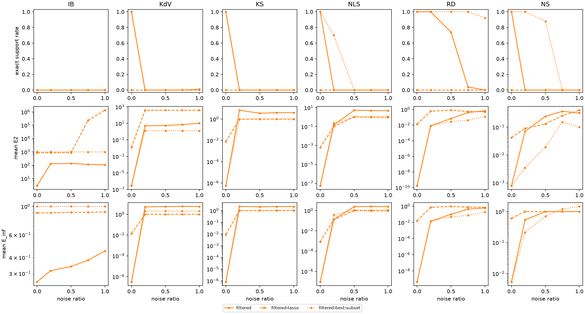

# WSINDy benchmark

Methods are defined in `run.py` (METHODS). TPR = TP/(TP+FN+FP); Exact = exact-support rate; E_inf = max relative error over true terms; E2 = relative coefficient L2 error; mean ± sample SD over trials, failures included. Seconds cover estimation, weak system and regression. Mean lambda / r: mean selected LASSO penalty, or best-subset sparsity bound r, per equation.

## Seeds

Noise seeds (trials) per noise level; noise ratios 0, 0.2, 0.5, 0.75, 1. Trial i uses the same seed for every method (pdes.trial_seed, root seed 0), so methods are compared on identical observations. At noise ratio 0 all trials coincide.

| Method | IB | KdV | KS | NLS | RD | NS |
| :--- | ---: | ---: | ---: | ---: | ---: | ---: |
| filtered | 100 | 100 | 100 | 100 | 100 | 100 |
| filtered-lasso | 100 | 100 | 100 | 100 | 100 | 100 |
| filtered-best-subset | 100 | 100 | 100 | 100 | 100 | 100 |

## Summary

Exact-support rate (%) · mean E_inf, per noise ratio.

| PDE | Method | 0 | 0.2 | 0.5 | 0.75 | 1 |
| :--- | :--- | ---: | ---: | ---: | ---: | ---: |
| IB | filtered | 0 · 0.26 | 0 · 0.32 | 0 · 0.34 | 0 · 0.38 | 0 · 0.45 |
| IB | filtered-lasso | 0 · 0.89 | 0 · 0.89 | 0 · 0.9 | 0 · 0.9 | 0 · 0.91 |
| IB | filtered-best-subset | 0 · 1 | 0 · 1 | 0 · 1 | 0 · 1 | 0 · 1 |
| KdV | filtered | 100 · 3.1e-07 | 0 · 5.2 | 0 · 5.6 | 0 · 5.8 | 1 · 5.7 |
| KdV | filtered-lasso | 0 · 0.014 | 0 · 1 | 0 · 1 | 0 · 1 | 0 · 1 |
| KdV | filtered-best-subset | 100 · 3.1e-07 | 0 · 2.1 | 0 · 2.1 | 0 · 2.1 | 0 · 2.1 |
| KS | filtered | 100 · 8.2e-07 | 0 · 2.3 | 0 · 2.1 | 0 · 2.2 | 0 · 2.2 |
| KS | filtered-lasso | 0 · 0.0092 | 0 · 1 | 0 · 1 | 0 · 1 | 0 · 1 |
| KS | filtered-best-subset | 100 · 8.2e-07 | 0 · 1 | 0 · 1 | 0 · 1 | 0 · 1.1 |
| NLS | filtered | 100 · 9.3e-08 | 0 · 0.13 | 0 · 2.4 | 0 · 2.6 | 0 · 2.4 |
| NLS | filtered-lasso | 0 · 0.00085 | 0 · 0.13 | 0 · 0.98 | 0 · 0.95 | 0 · 0.92 |
| NLS | filtered-best-subset | 100 · 9.3e-08 | 70 · 0.38 | 0 · 1.1 | 0 · 1.1 | 0 · 1.2 |
| RD | filtered | 100 · 4.5e-10 | 100 · 0.014 | 74 · 0.1 | 4 · 0.43 | 0 · 0.6 |
| RD | filtered-lasso | 0 · 0.015 | 0 · 0.72 | 0 · 0.93 | 0 · 0.77 | 0 · 0.7 |
| RD | filtered-best-subset | 100 · 4.5e-10 | 100 · 0.014 | 100 · 0.047 | 100 · 0.073 | 92 · 0.18 |
| NS | filtered | 100 · 0.0054 | 0 · 0.54 | 0 · 1 | 0 · 1 | 0 · 1 |
| NS | filtered-lasso | 0 · 0.61 | 0 · 1 | 0 · 1 | 0 · 1 | 0 · 1 |
| NS | filtered-best-subset | 100 · 0.0054 | 100 · 0.22 | 88 · 0.71 | 0 · 1.2 | 0 · 1.5 |

## IB

`u_t = -0.5 (u^2)_x`  

| Data U | X (K x J) | Y (K x E) | beta (J x E) | True nonzeros |
| :--- | :--- | :--- | :--- | :--- |
| 256 x 256 grid; components u | 784 x 43 | 784 x 1 | 43 x 1 | 1 of 43 (u_t: 1) |

K = weak equations (test-function centers), J = dictionary terms, E = equations. Test functions `Tests(m=(60, 60), p=(7, 7), s=(5, 5), shape='poly', tau=1e-10, tau_hat=2.0)`.

### Noise ratio 0

| Method | Trials | Exact | TPR | E_inf | E2 | Mean seconds | Mean lambda / r |
| :--- | ---: | ---: | ---: | ---: | ---: | ---: | :--- |
| filtered | 100 | 0.0% | 0.2 ± 5.58e-17 | 0.258283 ± 5.58e-17 | 2.88961 ± 4.46e-16 | 0.0215 | — |
| filtered-lasso | 100 | 0.0% | 0.5 ± 0 | 0.890185 ± 1.12e-16 | 870.704 ± 0 | 0.0258 | lambda_u=0.01517 |
| filtered-best-subset | 100 | 0.0% | 0 ± 0 | 1 ± 0 | 995.458 ± 0 | 0.0442 | r_u=1 |

### Noise ratio 0.2

| Method | Trials | Exact | TPR | E_inf | E2 | Mean seconds | Mean lambda / r |
| :--- | ---: | ---: | ---: | ---: | ---: | ---: | :--- |
| filtered | 100 | 0.0% | 0.170988 ± 0.0325 | 0.315689 ± 0.209 | 128.567 ± 263 | 0.0216 | — |
| filtered-lasso | 100 | 0.0% | 0.5 ± 0 | 0.891891 ± 0.00943 | 870.693 ± 10.7 | 0.0244 | lambda_u=0.01762 |
| filtered-best-subset | 100 | 0.0% | 0 ± 0 | 1 ± 0 | 996.239 ± 4.38 | 0.0449 | r_u=1 |

### Noise ratio 0.5

| Method | Trials | Exact | TPR | E_inf | E2 | Mean seconds | Mean lambda / r |
| :--- | ---: | ---: | ---: | ---: | ---: | ---: | :--- |
| filtered | 100 | 0.0% | 0.168206 ± 0.0387 | 0.340184 ± 0.278 | 135.368 ± 268 | 0.0211 | — |
| filtered-lasso | 100 | 0.0% | 0.491667 ± 0.0365 | 0.89946 ± 0.0208 | 871.311 ± 26.3 | 0.0238 | lambda_u=0.0236 |
| filtered-best-subset | 100 | 0.0% | 0 ± 0 | 1 ± 0 | 996.275 ± 13.1 | 0.046 | r_u=1 |

### Noise ratio 0.75

| Method | Trials | Exact | TPR | E_inf | E2 | Mean seconds | Mean lambda / r |
| :--- | ---: | ---: | ---: | ---: | ---: | ---: | :--- |
| filtered | 100 | 0.0% | 0.17306 ± 0.0415 | 0.38071 ± 0.337 | 114.619 ± 260 | 0.0212 | — |
| filtered-lasso | 100 | 0.0% | 0.474167 ± 0.0623 | 0.898433 ± 0.033 | 232531 ± 2.32e+06 | 0.0258 | lambda_u=0.02724 |
| filtered-best-subset | 100 | 0.0% | 0 ± 0 | 1 ± 0 | 992.486 ± 18.4 | 0.0444 | r_u=1 |

### Noise ratio 1

| Method | Trials | Exact | TPR | E_inf | E2 | Mean seconds | Mean lambda / r |
| :--- | ---: | ---: | ---: | ---: | ---: | ---: | :--- |
| filtered | 100 | 0.0% | 0.18081 ± 0.0423 | 0.449489 ± 0.433 | 105.431 ± 237 | 0.0203 | — |
| filtered-lasso | 100 | 0.0% | 0.446667 ± 0.108 | 0.905774 ± 0.0416 | 1.32148e+06 ± 5.85e+06 | 0.0328 | lambda_u=0.02975 |
| filtered-best-subset | 100 | 0.0% | 0 ± 0 | 1 ± 0 | 992.493 ± 23.5 | 0.0447 | r_u=1 |

## KdV

`u_t = -0.5 (u^2)_x - u_xxx`  

| Data U | X (K x J) | Y (K x E) | beta (J x E) | True nonzeros |
| :--- | :--- | :--- | :--- | :--- |
| 400 x 601 grid; components u | 1443 x 43 | 1443 x 1 | 43 x 1 | 2 of 43 (u_t: 2) |

K = weak equations (test-function centers), J = dictionary terms, E = equations. Test functions `Tests(m=(45, 80), p=(8, 7), s=(8, 12), shape='poly', tau=1e-10, tau_hat=2.0)`.

### Noise ratio 0

| Method | Trials | Exact | TPR | E_inf | E2 | Mean seconds | Mean lambda / r |
| :--- | ---: | ---: | ---: | ---: | ---: | ---: | :--- |
| filtered | 100 | 100.0% | 1 ± 0 | 3.13515e-07 ± 0 | 2.84321e-07 ± 1.06e-22 | 0.0602 | — |
| filtered-lasso | 100 | 0.0% | 0.5 ± 0 | 0.0139033 ± 5.23e-18 | 0.0124488 ± 5.23e-18 | 0.0642 | lambda_u=9.987e-05 |
| filtered-best-subset | 100 | 100.0% | 1 ± 0 | 3.13515e-07 ± 0 | 2.84321e-07 ± 5.32e-23 | 0.0969 | r_u=2 |

### Noise ratio 0.2

| Method | Trials | Exact | TPR | E_inf | E2 | Mean seconds | Mean lambda / r |
| :--- | ---: | ---: | ---: | ---: | ---: | ---: | :--- |
| filtered | 100 | 0.0% | 0.457302 ± 0.0955 | 5.19599 ± 1.6 | 4.97227 ± 1.8 | 0.0754 | — |
| filtered-lasso | 100 | 0.0% | 0.333333 ± 1.12e-16 | 1 ± 0 | 385.212 ± 0.817 | 0.0686 | lambda_u=0.03004 |
| filtered-best-subset | 100 | 0.0% | 0.333333 ± 1.12e-16 | 2.05373 ± 0.00472 | 1.28202 ± 0.00151 | 0.162 | r_u=2 |

### Noise ratio 0.5

| Method | Trials | Exact | TPR | E_inf | E2 | Mean seconds | Mean lambda / r |
| :--- | ---: | ---: | ---: | ---: | ---: | ---: | :--- |
| filtered | 100 | 0.0% | 0.44746 ± 0.107 | 5.61902 ± 1.09 | 5.52692 ± 1.53 | 0.0702 | — |
| filtered-lasso | 100 | 0.0% | 0.333333 ± 1.12e-16 | 1 ± 0 | 384.979 ± 2.34 | 0.0769 | lambda_u=0.02985 |
| filtered-best-subset | 100 | 0.0% | 0.333333 ± 1.12e-16 | 2.05343 ± 0.0114 | 1.28192 ± 0.00366 | 0.147 | r_u=2 |

### Noise ratio 0.75

| Method | Trials | Exact | TPR | E_inf | E2 | Mean seconds | Mean lambda / r |
| :--- | ---: | ---: | ---: | ---: | ---: | ---: | :--- |
| filtered | 100 | 0.0% | 0.417437 ± 0.114 | 5.75482 ± 0.741 | 7.00888 ± 11.1 | 0.0707 | — |
| filtered-lasso | 100 | 0.0% | 0.333333 ± 1.12e-16 | 1 ± 0 | 384.765 ± 3.65 | 0.0788 | lambda_u=0.02977 |
| filtered-best-subset | 100 | 0.0% | 0.333333 ± 1.12e-16 | 2.05216 ± 0.0141 | 1.28152 ± 0.00452 | 0.148 | r_u=2 |

### Noise ratio 1

| Method | Trials | Exact | TPR | E_inf | E2 | Mean seconds | Mean lambda / r |
| :--- | ---: | ---: | ---: | ---: | ---: | ---: | :--- |
| filtered | 100 | 1.0% | 0.397802 ± 0.142 | 5.66193 ± 1.24 | 10.5294 ± 22 | 0.0708 | — |
| filtered-lasso | 100 | 0.0% | 0.333333 ± 1.12e-16 | 1 ± 0 | 383.727 ± 4.36 | 0.0811 | lambda_u=0.02993 |
| filtered-best-subset | 100 | 0.0% | 0.333333 ± 1.12e-16 | 2.06729 ± 0.0823 | 1.2866 ± 0.0274 | 0.148 | r_u=2 |

## KS

`u_t = -0.5 (u^2)_x - u_xx - u_xxxx`  

| Data U | X (K x J) | Y (K x E) | beta (J x E) | True nonzeros |
| :--- | :--- | :--- | :--- | :--- |
| 256 x 301 grid; components u | 1806 x 43 | 1806 x 1 | 43 x 1 | 3 of 43 (u_t: 3) |

K = weak equations (test-function centers), J = dictionary terms, E = equations. Test functions `Tests(m=(23, 22), p=(10, 10), s=(5, 6), shape='poly', tau=1e-10, tau_hat=2.0)`.

### Noise ratio 0

| Method | Trials | Exact | TPR | E_inf | E2 | Mean seconds | Mean lambda / r |
| :--- | ---: | ---: | ---: | ---: | ---: | ---: | :--- |
| filtered | 100 | 100.0% | 1 ± 0 | 8.18316e-07 ± 0 | 5.54625e-07 ± 0 | 0.0182 | — |
| filtered-lasso | 100 | 0.0% | 0.272727 ± 5.58e-17 | 0.00920226 ± 0 | 0.00759012 ± 2.62e-18 | 0.0257 | lambda_u=5.794e-05 |
| filtered-best-subset | 100 | 100.0% | 1 ± 0 | 8.18316e-07 ± 0 | 5.54625e-07 ± 0 | 0.0364 | r_u=3 |

### Noise ratio 0.2

| Method | Trials | Exact | TPR | E_inf | E2 | Mean seconds | Mean lambda / r |
| :--- | ---: | ---: | ---: | ---: | ---: | ---: | :--- |
| filtered | 100 | 0.0% | 0.0723575 ± 0.0196 | 2.26388 ± 0.339 | 6.69491 ± 1.47 | 0.038 | — |
| filtered-lasso | 100 | 0.0% | 0.391619 ± 0.0277 | 1 ± 0 | 0.977837 ± 0.00175 | 0.0343 | lambda_u=0.03012 |
| filtered-best-subset | 100 | 0.0% | 0.5 ± 0 | 1 ± 0 | 0.959817 ± 0.000292 | 0.302 | r_u=3 |

### Noise ratio 0.5

| Method | Trials | Exact | TPR | E_inf | E2 | Mean seconds | Mean lambda / r |
| :--- | ---: | ---: | ---: | ---: | ---: | ---: | :--- |
| filtered | 100 | 0.0% | 0.0992914 ± 0.0272 | 2.10143 ± 0.407 | 3.50823 ± 2.15 | 0.0374 | — |
| filtered-lasso | 100 | 0.0% | 0.00666667 ± 0.0328 | 1 ± 0 | 0.999641 ± 0.00198 | 0.0296 | lambda_u=0.05899 |
| filtered-best-subset | 100 | 0.0% | 0.198 ± 0.02 | 1.02587 ± 0.0781 | 0.975942 ± 0.0204 | 0.124 | r_u=3 |

### Noise ratio 0.75

| Method | Trials | Exact | TPR | E_inf | E2 | Mean seconds | Mean lambda / r |
| :--- | ---: | ---: | ---: | ---: | ---: | ---: | :--- |
| filtered | 100 | 0.0% | 0.0895441 ± 0.0297 | 2.20814 ± 0.423 | 4.02027 ± 2.05 | 0.0369 | — |
| filtered-lasso | 100 | 0.0% | 0.0317143 ± 0.0732 | 1.00071 ± 0.00502 | 0.998044 ± 0.00451 | 0.0288 | lambda_u=0.05513 |
| filtered-best-subset | 100 | 0.0% | 0.19 ± 0.0438 | 1.02341 ± 0.0751 | 0.976731 ± 0.0204 | 0.145 | r_u=3 |

### Noise ratio 1

| Method | Trials | Exact | TPR | E_inf | E2 | Mean seconds | Mean lambda / r |
| :--- | ---: | ---: | ---: | ---: | ---: | ---: | :--- |
| filtered | 100 | 0.0% | 0.090529 ± 0.0351 | 2.20801 ± 0.422 | 4.03428 ± 2.03 | 0.0375 | — |
| filtered-lasso | 100 | 0.0% | 0.0248095 ± 0.0665 | 1.00147 ± 0.00871 | 0.998598 ± 0.00387 | 0.0289 | lambda_u=0.05461 |
| filtered-best-subset | 100 | 0.0% | 0.174 ± 0.0676 | 1.06854 ± 0.117 | 0.991017 ± 0.0297 | 0.17 | r_u=3 |

## NLS

`u_t = 0.5 v_xx + u^2 v + v^3`  
`v_t = -0.5 u_xx - u v^2 - u^3`  

| Data U | X (K x J) | Y (K x E) | beta (J x E) | True nonzeros |
| :--- | :--- | :--- | :--- | :--- |
| 256 x 251 grid; components u, v | 1804 x 190 | 1804 x 2 | 190 x 2 | 6 of 380 (u_t: 3, v_t: 3) |

K = weak equations (test-function centers), J = dictionary terms, E = equations. Test functions `Tests(m=(19, 25), p=(11, 10), s=(5, 5), shape='poly', tau=1e-10, tau_hat=2.0)`.

### Noise ratio 0

| Method | Trials | Exact | TPR | E_inf | E2 | Mean seconds | Mean lambda / r |
| :--- | ---: | ---: | ---: | ---: | ---: | ---: | :--- |
| filtered | 100 | 100.0% | 1 ± 0 | 9.28616e-08 ± 0 | 5.60489e-08 ± 6.65e-24 | 0.0841 | — |
| filtered-lasso | 100 | 0.0% | 0.5 ± 0 | 0.00084906 ± 0 | 0.000618916 ± 1.09e-19 | 0.107 | lambda_u=9.083e-05, lambda_v=9.087e-05 |
| filtered-best-subset | 100 | 100.0% | 1 ± 0 | 9.28616e-08 ± 0 | 5.60489e-08 ± 6.65e-24 | 0.383 | r_u=3, r_v=3 |

### Noise ratio 0.2

| Method | Trials | Exact | TPR | E_inf | E2 | Mean seconds | Mean lambda / r |
| :--- | ---: | ---: | ---: | ---: | ---: | ---: | :--- |
| filtered | 100 | 0.0% | 0.662469 ± 0.0953 | 0.134777 ± 0.0371 | 0.149227 ± 0.0358 | 0.548 | — |
| filtered-lasso | 100 | 0.0% | 0.274269 ± 0.0301 | 0.128724 ± 0.0133 | 0.105388 ± 0.00935 | 0.126 | lambda_u=0.007182, lambda_v=0.007184 |
| filtered-best-subset | 100 | 70.0% | 0.889524 ± 0.183 | 0.382968 ± 0.406 | 0.230257 ± 0.207 | 29.8 | r_u=3, r_v=3 |

### Noise ratio 0.5

| Method | Trials | Exact | TPR | E_inf | E2 | Mean seconds | Mean lambda / r |
| :--- | ---: | ---: | ---: | ---: | ---: | ---: | :--- |
| filtered | 100 | 0.0% | 0.129448 ± 0.0584 | 2.41777 ± 0.798 | 5.35843 ± 1.9 | 0.965 | — |
| filtered-lasso | 100 | 0.0% | 0.120304 ± 0.0274 | 0.983704 ± 0.0607 | 1.05245 ± 0.0863 | 0.137 | lambda_u=0.01283, lambda_v=0.01284 |
| filtered-best-subset | 100 | 0.0% | 0.164121 ± 0.105 | 1.13574 ± 0.421 | 1.06035 ± 0.246 | 30.3 | r_u=3, r_v=3 |

### Noise ratio 0.75

| Method | Trials | Exact | TPR | E_inf | E2 | Mean seconds | Mean lambda / r |
| :--- | ---: | ---: | ---: | ---: | ---: | ---: | :--- |
| filtered | 100 | 0.0% | 0.131142 ± 0.0416 | 2.57529 ± 0.767 | 4.97586 ± 2.05 | 1.04 | — |
| filtered-lasso | 100 | 0.0% | 0.131838 ± 0.0366 | 0.947129 ± 0.0988 | 0.98706 ± 0.122 | 0.157 | lambda_u=0.01339, lambda_v=0.0134 |
| filtered-best-subset | 100 | 0.0% | 0.158061 ± 0.103 | 1.08205 ± 0.329 | 1.0799 ± 0.233 | 30.3 | r_u=3, r_v=3 |

### Noise ratio 1

| Method | Trials | Exact | TPR | E_inf | E2 | Mean seconds | Mean lambda / r |
| :--- | ---: | ---: | ---: | ---: | ---: | ---: | :--- |
| filtered | 100 | 0.0% | 0.123039 ± 0.0372 | 2.42934 ± 0.906 | 4.83771 ± 1.67 | 1.09 | — |
| filtered-lasso | 100 | 0.0% | 0.139004 ± 0.0349 | 0.918399 ± 0.127 | 0.950743 ± 0.125 | 0.142 | lambda_u=0.0141, lambda_v=0.01409 |
| filtered-best-subset | 100 | 0.0% | 0.173485 ± 0.108 | 1.17418 ± 0.465 | 1.11052 ± 0.278 | 30.4 | r_u=3, r_v=3 |

## RD

`u_t = 0.1 u_xx + 0.1 u_yy - u v^2 - u^3 + v^3 + u^2 v + u`  
`v_t = 0.1 v_xx + 0.1 v_yy - u v^2 - u^3 - v^3 - u^2 v + v`  

| Data U | X (K x J) | Y (K x E) | beta (J x E) | True nonzeros |
| :--- | :--- | :--- | :--- | :--- |
| 256 x 256 x 201 grid; components u, v | 4860 x 181 | 4860 x 2 | 181 x 2 | 14 of 362 (u_t: 7, v_t: 7) |

K = weak equations (test-function centers), J = dictionary terms, E = equations. Test functions `Tests(m=(13, 13, 14), p=(13, 13, 12), s=(13, 13, 12), shape='poly', tau=1e-10, tau_hat=2.0)`.

### Noise ratio 0

| Method | Trials | Exact | TPR | E_inf | E2 | Mean seconds | Mean lambda / r |
| :--- | ---: | ---: | ---: | ---: | ---: | ---: | :--- |
| filtered | 100 | 100.0% | 1 ± 0 | 4.45443e-10 ± 0 | 1.79099e-10 ± 2.6e-26 | 11.5 | — |
| filtered-lasso | 100 | 0.0% | 0.35 ± 1.12e-16 | 0.0153923 ± 0 | 0.0134158 ± 1.74e-18 | 15.7 | lambda_u=8.461e-05, lambda_v=8.463e-05 |
| filtered-best-subset | 100 | 100.0% | 1 ± 0 | 4.4544e-10 ± 0 | 1.79098e-10 ± 7.79e-26 | 40.1 | r_u=7, r_v=7 |

### Noise ratio 0.2

| Method | Trials | Exact | TPR | E_inf | E2 | Mean seconds | Mean lambda / r |
| :--- | ---: | ---: | ---: | ---: | ---: | ---: | :--- |
| filtered | 100 | 100.0% | 1 ± 0 | 0.0135013 ± 0.00292 | 0.00771947 ± 0.00135 | 11.3 | — |
| filtered-lasso | 100 | 0.0% | 0.315114 ± 0.021 | 0.715256 ± 0.201 | 0.584312 ± 0.223 | 16.7 | lambda_u=0.005211, lambda_v=0.005212 |
| filtered-best-subset | 100 | 100.0% | 1 ± 0 | 0.0135013 ± 0.00292 | 0.00771947 ± 0.00135 | 42.2 | r_u=7, r_v=7 |

### Noise ratio 0.5

| Method | Trials | Exact | TPR | E_inf | E2 | Mean seconds | Mean lambda / r |
| :--- | ---: | ---: | ---: | ---: | ---: | ---: | :--- |
| filtered | 100 | 74.0% | 0.959036 ± 0.0753 | 0.0999785 ± 0.0902 | 0.068204 ± 0.0731 | 11.5 | — |
| filtered-lasso | 100 | 0.0% | 0.290288 ± 0.0188 | 0.932402 ± 0.132 | 0.779452 ± 0.177 | 17.7 | lambda_u=0.009098, lambda_v=0.0091 |
| filtered-best-subset | 100 | 100.0% | 1 ± 0 | 0.0472529 ± 0.00606 | 0.0269209 ± 0.00198 | 38.4 | r_u=7, r_v=7 |

### Noise ratio 0.75

| Method | Trials | Exact | TPR | E_inf | E2 | Mean seconds | Mean lambda / r |
| :--- | ---: | ---: | ---: | ---: | ---: | ---: | :--- |
| filtered | 100 | 4.0% | 0.751797 ± 0.1 | 0.426226 ± 0.126 | 0.402213 ± 0.146 | 10.5 | — |
| filtered-lasso | 100 | 0.0% | 0.295891 ± 0.0211 | 0.766422 ± 0.181 | 0.548757 ± 0.199 | 19.7 | lambda_u=0.007684, lambda_v=0.007684 |
| filtered-best-subset | 100 | 100.0% | 1 ± 0 | 0.0729753 ± 0.00494 | 0.043535 ± 0.00182 | 42.4 | r_u=7, r_v=7 |

### Noise ratio 1

| Method | Trials | Exact | TPR | E_inf | E2 | Mean seconds | Mean lambda / r |
| :--- | ---: | ---: | ---: | ---: | ---: | ---: | :--- |
| filtered | 100 | 0.0% | 0.618625 ± 0.11 | 0.598599 ± 0.0527 | 0.65562 ± 0.151 | 11.9 | — |
| filtered-lasso | 100 | 0.0% | 0.296331 ± 0.0231 | 0.70345 ± 0.209 | 0.481669 ± 0.191 | 18.3 | lambda_u=0.007986, lambda_v=0.007988 |
| filtered-best-subset | 100 | 92.0% | 0.985833 ± 0.0509 | 0.179957 ± 0.269 | 0.123066 ± 0.211 | 47.4 | r_u=7, r_v=7 |

## NS

`omega_t = -(omega u)_x - (omega v)_y + 0.01 omega_xx + 0.01 omega_yy`  

| Data U | X (K x J) | Y (K x E) | beta (J x E) | True nonzeros |
| :--- | :--- | :--- | :--- | :--- |
| 324 x 149 x 201 grid; components omega, u, v | 3872 x 50 | 3872 x 1 | 50 x 1 | 4 of 50 (omega_t: 4) |

K = weak equations (test-function centers), J = dictionary terms, E = equations. Test functions `Tests(m=(31, 31, 14), p=(9, 9, 12), s=(12, 12, 8), shape='poly', tau=1e-10, tau_hat=2.0)`.

### Noise ratio 0

| Method | Trials | Exact | TPR | E_inf | E2 | Mean seconds | Mean lambda / r |
| :--- | ---: | ---: | ---: | ---: | ---: | ---: | :--- |
| filtered | 100 | 100.0% | 1 ± 0 | 0.00537952 ± 2.62e-18 | 0.000789496 ± 2.18e-19 | 3.66 | — |
| filtered-lasso | 100 | 0.0% | 0.571429 ± 2.23e-16 | 0.606835 ± 1.12e-16 | 0.0425387 ± 6.97e-18 | 4.77 | lambda_omega=0.00602 |
| filtered-best-subset | 100 | 100.0% | 1 ± 0 | 0.00537952 ± 8.72e-19 | 0.000789496 ± 4.36e-19 | 10.1 | r_omega=4 |

### Noise ratio 0.2

| Method | Trials | Exact | TPR | E_inf | E2 | Mean seconds | Mean lambda / r |
| :--- | ---: | ---: | ---: | ---: | ---: | ---: | :--- |
| filtered | 100 | 0.0% | 0.606333 ± 0.225 | 0.542068 ± 0.384 | 0.0704365 ± 0.0196 | 4.02 | — |
| filtered-lasso | 100 | 0.0% | 0.5 ± 0 | 1 ± 0 | 0.0901335 ± 0.00484 | 4.9 | lambda_omega=0.02024 |
| filtered-best-subset | 100 | 100.0% | 1 ± 0 | 0.215732 ± 0.00524 | 0.00352093 ± 0.000396 | 12.3 | r_omega=4 |

### Noise ratio 0.5

| Method | Trials | Exact | TPR | E_inf | E2 | Mean seconds | Mean lambda / r |
| :--- | ---: | ---: | ---: | ---: | ---: | ---: | :--- |
| filtered | 100 | 0.0% | 0.31381 ± 0.0235 | 1 ± 0 | 0.244773 ± 0.0726 | 3.87 | — |
| filtered-lasso | 100 | 0.0% | 0.375 ± 0 | 1 ± 0 | 0.130315 ± 0.011 | 4.86 | lambda_omega=0.01506 |
| filtered-best-subset | 100 | 88.0% | 0.952 ± 0.131 | 0.708983 ± 0.109 | 0.0193623 ± 0.0341 | 45.4 | r_omega=4 |

### Noise ratio 0.75

| Method | Trials | Exact | TPR | E_inf | E2 | Mean seconds | Mean lambda / r |
| :--- | ---: | ---: | ---: | ---: | ---: | ---: | :--- |
| filtered | 100 | 0.0% | 0.309008 ± 0.102 | 1 ± 0 | 0.370325 ± 0.198 | 3.83 | — |
| filtered-lasso | 100 | 0.0% | 0.320348 ± 0.0279 | 1 ± 0 | 0.259175 ± 0.0206 | 5.28 | lambda_omega=0.03186 |
| filtered-best-subset | 100 | 0.0% | 0.6 ± 0 | 1.21106 ± 0.0706 | 0.15262 ± 0.0588 | 43.4 | r_omega=4 |

### Noise ratio 1

| Method | Trials | Exact | TPR | E_inf | E2 | Mean seconds | Mean lambda / r |
| :--- | ---: | ---: | ---: | ---: | ---: | ---: | :--- |
| filtered | 100 | 0.0% | 0.30867 ± 0.054 | 1 ± 0 | 0.322707 ± 0.124 | 3.75 | — |
| filtered-lasso | 100 | 0.0% | 0.231923 ± 0.00459 | 1 ± 0 | 0.404132 ± 0.0133 | 5.34 | lambda_omega=0.005189 |
| filtered-best-subset | 100 | 0.0% | 0.6 ± 0 | 1.47411 ± 0.147 | 0.101451 ± 0.081 | 13.8 | r_omega=4 |
