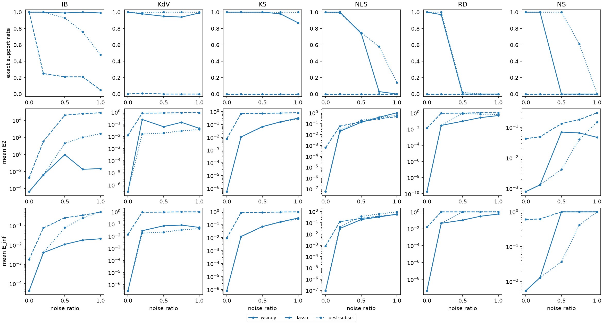

# WSINDy benchmark

Methods are defined in `run.py` (METHODS). TPR = TP/(TP+FN+FP); Exact = exact-support rate; E_inf = max relative error over true terms; E2 = relative coefficient L2 error; mean ± sample SD over trials, failures included. Seconds cover estimation, weak system and regression. Mean lambda / r: mean selected LASSO penalty, or best-subset sparsity bound r, per equation.

## Seeds

Noise seeds (trials) per noise level; noise ratios 0, 0.2, 0.5, 0.75, 1. Trial i uses the same seed for every method (pdes.trial_seed, root seed 0), so methods are compared on identical observations. At noise ratio 0 all trials coincide.

| Method | IB | KdV | KS | NLS | RD | NS |
| :--- | ---: | ---: | ---: | ---: | ---: | ---: |
| wsindy | 100 | 100 | 100 | 100 | 100 | 100 |
| lasso | 100 | 100 | 100 | 100 | 100 | 100 |
| best-subset | 100 | 100 | 100 | 100 | 100 | 100 |

## Summary

Exact-support rate (%) · mean E_inf, per noise ratio.

| PDE | Method | 0 | 0.2 | 0.5 | 0.75 | 1 |
| :--- | :--- | ---: | ---: | ---: | ---: | ---: |
| IB | wsindy | 100 · 4.3e-05 | 100 · 0.0041 | 99 · 0.011 | 100 · 0.018 | 99 · 0.021 |
| IB | lasso | 100 · 0.0018 | 25 · 0.078 | 21 · 0.26 | 21 · 0.35 | 5 · 0.53 |
| IB | best-subset | 100 · 4.3e-05 | 100 · 0.0041 | 93 · 0.08 | 76 · 0.25 | 48 · 0.53 |
| KdV | wsindy | 100 · 3.1e-07 | 98 · 0.028 | 95 · 0.071 | 94 · 0.081 | 99 · 0.052 |
| KdV | lasso | 0 · 0.014 | 1 · 0.93 | 0 · 0.96 | 0 · 1 | 0 · 0.99 |
| KdV | best-subset | 100 · 3.1e-07 | 99 · 0.018 | 100 · 0.021 | 100 · 0.032 | 100 · 0.042 |
| KS | wsindy | 100 · 8.2e-07 | 100 · 0.012 | 100 · 0.072 | 98 · 0.16 | 87 · 0.33 |
| KS | lasso | 0 · 0.0092 | 0 · 0.87 | 0 · 0.9 | 0 · 0.96 | 0 · 0.98 |
| KS | best-subset | 100 · 8.2e-07 | 100 · 0.012 | 100 · 0.072 | 100 · 0.16 | 100 · 0.28 |
| NLS | wsindy | 100 · 9.3e-08 | 100 · 0.031 | 74 · 0.19 | 3 · 0.33 | 0 · 0.59 |
| NLS | lasso | 0 · 0.00085 | 0 · 0.13 | 0 · 0.24 | 0 · 0.38 | 0 · 0.54 |
| NLS | best-subset | 100 · 9.3e-08 | 99 · 0.041 | 75 · 0.37 | 58 · 0.6 | 14 · 0.92 |
| RD | wsindy | 100 · 4.5e-10 | 97 · 0.044 | 0 · 0.11 | 0 · 0.3 | 0 · 0.55 |
| RD | lasso | 0 · 0.015 | 0 · 1 | 0 · 1 | 0 · 1 | 0 · 1 |
| RD | best-subset | 100 · 4.5e-10 | 100 · 0.045 | 2 · 0.98 | 0 · 1 | 0 · 1 |
| NS | wsindy | 100 · 0.0054 | 100 · 0.013 | 0 · 1 | 0 · 1 | 0 · 1 |
| NS | lasso | 0 · 0.61 | 0 · 0.62 | 0 · 1 | 0 · 1 | 0 · 1 |
| NS | best-subset | 100 · 0.0054 | 100 · 0.013 | 100 · 0.037 | 61 · 0.42 | 0 · 1 |

## IB

`u_t = -0.5 (u^2)_x`  

| Data U | X (K x J) | Y (K x E) | beta (J x E) | True nonzeros |
| :--- | :--- | :--- | :--- | :--- |
| 256 x 256 grid; components u | 784 x 43 | 784 x 1 | 43 x 1 | 1 of 43 (u_t: 1) |

K = weak equations (test-function centers), J = dictionary terms, E = equations. Test functions `Tests(m=(60, 60), p=(7, 7), s=(5, 5), shape='poly', tau=1e-10, tau_hat=2.0)`.

### Noise ratio 0

| Method | Trials | Exact | TPR | E_inf | E2 | Mean seconds | Mean lambda / r |
| :--- | ---: | ---: | ---: | ---: | ---: | ---: | :--- |
| wsindy | 100 | 100.0% | 1 ± 0 | 4.30846e-05 ± 0 | 4.30846e-05 ± 0 | 0.0252 | — |
| lasso | 100 | 100.0% | 1 ± 0 | 0.00183166 ± 0 | 0.00183166 ± 0 | 0.0337 | lambda_u=0.001789 |
| best-subset | 100 | 100.0% | 1 ± 0 | 4.30846e-05 ± 0 | 4.30846e-05 ± 0 | 0.0246 | r_u=1 |

### Noise ratio 0.2

| Method | Trials | Exact | TPR | E_inf | E2 | Mean seconds | Mean lambda / r |
| :--- | ---: | ---: | ---: | ---: | ---: | ---: | :--- |
| wsindy | 100 | 100.0% | 1 ± 0 | 0.00408295 ± 0.00318 | 0.00408295 ± 0.00318 | 0.0258 | — |
| lasso | 100 | 25.0% | 0.625 ± 0.218 | 0.0778663 ± 0.0679 | 34.6959 ± 44.8 | 0.0384 | lambda_u=0.01324 |
| best-subset | 100 | 100.0% | 1 ± 0 | 0.00408295 ± 0.00318 | 0.00408295 ± 0.00318 | 0.0332 | r_u=1 |

### Noise ratio 0.5

| Method | Trials | Exact | TPR | E_inf | E2 | Mean seconds | Mean lambda / r |
| :--- | ---: | ---: | ---: | ---: | ---: | ---: | :--- |
| wsindy | 100 | 99.0% | 0.991111 ± 0.0889 | 0.0109775 ± 0.0094 | 0.940651 ± 9.3 | 0.025 | — |
| lasso | 100 | 21.0% | 0.561667 ± 0.261 | 0.262172 ± 0.278 | 40544 ± 4.03e+05 | 0.039 | lambda_u=0.02681 |
| best-subset | 100 | 93.0% | 0.93 ± 0.256 | 0.0802429 ± 0.254 | 20.0816 ± 141 | 0.0338 | r_u=1 |

### Noise ratio 0.75

| Method | Trials | Exact | TPR | E_inf | E2 | Mean seconds | Mean lambda / r |
| :--- | ---: | ---: | ---: | ---: | ---: | ---: | :--- |
| wsindy | 100 | 100.0% | 1 ± 0 | 0.0182255 ± 0.0129 | 0.0182255 ± 0.0129 | 0.0237 | — |
| lasso | 100 | 21.0% | 0.540833 ± 0.272 | 0.349902 ± 0.268 | 61863.4 ± 6.16e+05 | 0.04 | lambda_u=0.04173 |
| best-subset | 100 | 76.0% | 0.76 ± 0.429 | 0.253209 ± 0.422 | 99.8672 ± 301 | 0.034 | r_u=1 |

### Noise ratio 1

| Method | Trials | Exact | TPR | E_inf | E2 | Mean seconds | Mean lambda / r |
| :--- | ---: | ---: | ---: | ---: | ---: | ---: | :--- |
| wsindy | 100 | 99.0% | 0.995 ± 0.05 | 0.0214272 ± 0.0151 | 0.0219393 ± 0.016 | 0.0248 | — |
| lasso | 100 | 5.0% | 0.416667 ± 0.203 | 0.526774 ± 0.286 | 77815.3 ± 7.72e+05 | 0.041 | lambda_u=0.04705 |
| best-subset | 100 | 48.0% | 0.48 ± 0.502 | 0.529228 ± 0.493 | 277.539 ± 447 | 0.0338 | r_u=1 |

## KdV

`u_t = -0.5 (u^2)_x - u_xxx`  

| Data U | X (K x J) | Y (K x E) | beta (J x E) | True nonzeros |
| :--- | :--- | :--- | :--- | :--- |
| 400 x 601 grid; components u | 1443 x 43 | 1443 x 1 | 43 x 1 | 2 of 43 (u_t: 2) |

K = weak equations (test-function centers), J = dictionary terms, E = equations. Test functions `Tests(m=(45, 80), p=(8, 7), s=(8, 12), shape='poly', tau=1e-10, tau_hat=2.0)`.

### Noise ratio 0

| Method | Trials | Exact | TPR | E_inf | E2 | Mean seconds | Mean lambda / r |
| :--- | ---: | ---: | ---: | ---: | ---: | ---: | :--- |
| wsindy | 100 | 100.0% | 1 ± 0 | 3.13515e-07 ± 0 | 2.84321e-07 ± 1.06e-22 | 0.071 | — |
| lasso | 100 | 0.0% | 0.5 ± 0 | 0.0139033 ± 5.23e-18 | 0.0124488 ± 5.23e-18 | 0.11 | lambda_u=9.987e-05 |
| best-subset | 100 | 100.0% | 1 ± 0 | 3.13515e-07 ± 0 | 2.84321e-07 ± 5.32e-23 | 0.0704 | r_u=2 |

### Noise ratio 0.2

| Method | Trials | Exact | TPR | E_inf | E2 | Mean seconds | Mean lambda / r |
| :--- | ---: | ---: | ---: | ---: | ---: | ---: | :--- |
| wsindy | 100 | 98.0% | 0.988333 ± 0.0829 | 0.0277983 ± 0.14 | 0.250095 ± 2.34 | 0.0776 | — |
| lasso | 100 | 1.0% | 0.286667 ± 0.129 | 0.927385 ± 0.248 | 0.830413 ± 0.222 | 0.117 | lambda_u=0.006917 |
| best-subset | 100 | 99.0% | 0.993333 ± 0.0667 | 0.017761 ± 0.0994 | 0.0158931 ± 0.0889 | 0.102 | r_u=2 |

### Noise ratio 0.5

| Method | Trials | Exact | TPR | E_inf | E2 | Mean seconds | Mean lambda / r |
| :--- | ---: | ---: | ---: | ---: | ---: | ---: | :--- |
| wsindy | 100 | 95.0% | 0.971667 ± 0.125 | 0.0706185 ± 0.215 | 0.0631837 ± 0.192 | 0.0783 | — |
| lasso | 100 | 0.0% | 0.275 ± 0.0995 | 0.958036 ± 0.168 | 0.857904 ± 0.15 | 0.119 | lambda_u=0.007107 |
| best-subset | 100 | 100.0% | 1 ± 0 | 0.0213939 ± 0.0164 | 0.0191497 ± 0.0147 | 0.102 | r_u=2 |

### Noise ratio 0.75

| Method | Trials | Exact | TPR | E_inf | E2 | Mean seconds | Mean lambda / r |
| :--- | ---: | ---: | ---: | ---: | ---: | ---: | :--- |
| wsindy | 100 | 94.0% | 0.971667 ± 0.114 | 0.0813984 ± 0.213 | 0.146024 ± 0.751 | 0.0756 | — |
| lasso | 100 | 0.0% | 0.265833 ± 0.0498 | 0.995386 ± 0.0461 | 0.891908 ± 0.0414 | 0.12 | lambda_u=0.01042 |
| best-subset | 100 | 100.0% | 1 ± 0 | 0.0324244 ± 0.0241 | 0.0290362 ± 0.0215 | 0.107 | r_u=2 |

### Noise ratio 1

| Method | Trials | Exact | TPR | E_inf | E2 | Mean seconds | Mean lambda / r |
| :--- | ---: | ---: | ---: | ---: | ---: | ---: | :--- |
| wsindy | 100 | 99.0% | 0.995 ± 0.05 | 0.0520222 ± 0.103 | 0.0465661 ± 0.0917 | 0.0759 | — |
| lasso | 100 | 0.0% | 0.2975 ± 0.0559 | 0.994591 ± 0.0541 | 0.892453 ± 0.0487 | 0.126 | lambda_u=0.01778 |
| best-subset | 100 | 100.0% | 1 ± 0 | 0.0421661 ± 0.0368 | 0.0377484 ± 0.0329 | 0.109 | r_u=2 |

## KS

`u_t = -0.5 (u^2)_x - u_xx - u_xxxx`  

| Data U | X (K x J) | Y (K x E) | beta (J x E) | True nonzeros |
| :--- | :--- | :--- | :--- | :--- |
| 256 x 301 grid; components u | 1806 x 43 | 1806 x 1 | 43 x 1 | 3 of 43 (u_t: 3) |

K = weak equations (test-function centers), J = dictionary terms, E = equations. Test functions `Tests(m=(23, 22), p=(10, 10), s=(5, 6), shape='poly', tau=1e-10, tau_hat=2.0)`.

### Noise ratio 0

| Method | Trials | Exact | TPR | E_inf | E2 | Mean seconds | Mean lambda / r |
| :--- | ---: | ---: | ---: | ---: | ---: | ---: | :--- |
| wsindy | 100 | 100.0% | 1 ± 0 | 8.18316e-07 ± 0 | 5.54625e-07 ± 0 | 0.0178 | — |
| lasso | 100 | 0.0% | 0.272727 ± 5.58e-17 | 0.00920226 ± 0 | 0.00759012 ± 2.62e-18 | 0.052 | lambda_u=5.794e-05 |
| best-subset | 100 | 100.0% | 1 ± 0 | 8.18316e-07 ± 0 | 5.54625e-07 ± 0 | 0.0294 | r_u=3 |

### Noise ratio 0.2

| Method | Trials | Exact | TPR | E_inf | E2 | Mean seconds | Mean lambda / r |
| :--- | ---: | ---: | ---: | ---: | ---: | ---: | :--- |
| wsindy | 100 | 100.0% | 1 ± 0 | 0.0122972 ± 0.00551 | 0.0104377 ± 0.0056 | 0.0428 | — |
| lasso | 100 | 0.0% | 0.285054 ± 0.0251 | 0.866745 ± 0.257 | 0.711172 ± 0.211 | 0.0547 | lambda_u=0.01035 |
| best-subset | 100 | 100.0% | 1 ± 0 | 0.0122972 ± 0.00551 | 0.0104377 ± 0.0056 | 0.0318 | r_u=3 |

### Noise ratio 0.5

| Method | Trials | Exact | TPR | E_inf | E2 | Mean seconds | Mean lambda / r |
| :--- | ---: | ---: | ---: | ---: | ---: | ---: | :--- |
| wsindy | 100 | 100.0% | 1 ± 0 | 0.0722229 ± 0.0168 | 0.0670009 ± 0.0173 | 0.0454 | — |
| lasso | 100 | 0.0% | 0.262917 ± 0.0333 | 0.903213 ± 0.203 | 0.737055 ± 0.166 | 0.0567 | lambda_u=0.01124 |
| best-subset | 100 | 100.0% | 1 ± 0 | 0.0722229 ± 0.0168 | 0.0670009 ± 0.0173 | 0.0368 | r_u=3 |

### Noise ratio 0.75

| Method | Trials | Exact | TPR | E_inf | E2 | Mean seconds | Mean lambda / r |
| :--- | ---: | ---: | ---: | ---: | ---: | ---: | :--- |
| wsindy | 100 | 98.0% | 0.995 ± 0.0352 | 0.164424 ± 0.0274 | 0.15789 ± 0.0246 | 0.0505 | — |
| lasso | 100 | 0.0% | 0.26944 ± 0.0447 | 0.956166 ± 0.16 | 0.780472 ± 0.126 | 0.047 | lambda_u=0.01523 |
| best-subset | 100 | 100.0% | 1 ± 0 | 0.162706 ± 0.0208 | 0.156629 ± 0.0209 | 0.0415 | r_u=3 |

### Noise ratio 1

| Method | Trials | Exact | TPR | E_inf | E2 | Mean seconds | Mean lambda / r |
| :--- | ---: | ---: | ---: | ---: | ---: | ---: | :--- |
| wsindy | 100 | 87.0% | 0.943357 ± 0.158 | 0.326388 ± 0.222 | 0.309675 ± 0.172 | 0.0494 | — |
| lasso | 100 | 0.0% | 0.289096 ± 0.0508 | 0.979625 ± 0.104 | 0.816684 ± 0.0799 | 0.0471 | lambda_u=0.02046 |
| best-subset | 100 | 100.0% | 1 ± 0 | 0.281163 ± 0.028 | 0.272792 ± 0.0273 | 0.051 | r_u=3 |

## NLS

`u_t = 0.5 v_xx + u^2 v + v^3`  
`v_t = -0.5 u_xx - u v^2 - u^3`  

| Data U | X (K x J) | Y (K x E) | beta (J x E) | True nonzeros |
| :--- | :--- | :--- | :--- | :--- |
| 256 x 251 grid; components u, v | 1804 x 190 | 1804 x 2 | 190 x 2 | 6 of 380 (u_t: 3, v_t: 3) |

K = weak equations (test-function centers), J = dictionary terms, E = equations. Test functions `Tests(m=(19, 25), p=(11, 10), s=(5, 5), shape='poly', tau=1e-10, tau_hat=2.0)`.

### Noise ratio 0

| Method | Trials | Exact | TPR | E_inf | E2 | Mean seconds | Mean lambda / r |
| :--- | ---: | ---: | ---: | ---: | ---: | ---: | :--- |
| wsindy | 100 | 100.0% | 1 ± 0 | 9.28616e-08 ± 0 | 5.60489e-08 ± 6.65e-24 | 0.0795 | — |
| lasso | 100 | 0.0% | 0.5 ± 0 | 0.00084906 ± 0 | 0.000618916 ± 1.09e-19 | 0.208 | lambda_u=9.083e-05, lambda_v=9.087e-05 |
| best-subset | 100 | 100.0% | 1 ± 0 | 9.28616e-08 ± 0 | 5.60489e-08 ± 6.65e-24 | 0.309 | r_u=3, r_v=3 |

### Noise ratio 0.2

| Method | Trials | Exact | TPR | E_inf | E2 | Mean seconds | Mean lambda / r |
| :--- | ---: | ---: | ---: | ---: | ---: | ---: | :--- |
| wsindy | 100 | 100.0% | 1 ± 0 | 0.031011 ± 0.00358 | 0.0200444 ± 0.00267 | 0.568 | — |
| lasso | 100 | 0.0% | 0.359777 ± 0.0326 | 0.126324 ± 0.0103 | 0.0593371 ± 0.00781 | 0.201 | lambda_u=0.006863, lambda_v=0.006866 |
| best-subset | 100 | 99.0% | 0.997143 ± 0.0286 | 0.0406566 ± 0.097 | 0.0246631 ± 0.0464 | 13.7 | r_u=3, r_v=3 |

### Noise ratio 0.5

| Method | Trials | Exact | TPR | E_inf | E2 | Mean seconds | Mean lambda / r |
| :--- | ---: | ---: | ---: | ---: | ---: | ---: | :--- |
| wsindy | 100 | 74.0% | 0.940207 ± 0.124 | 0.192192 ± 0.166 | 0.13637 ± 0.0799 | 0.789 | — |
| lasso | 100 | 0.0% | 0.245019 ± 0.0222 | 0.243522 ± 0.0198 | 0.154701 ± 0.0104 | 0.26 | lambda_u=0.007891, lambda_v=0.007894 |
| best-subset | 100 | 75.0% | 0.922619 ± 0.141 | 0.369022 ± 0.366 | 0.202324 ± 0.167 | 30 | r_u=3, r_v=3 |

### Noise ratio 0.75

| Method | Trials | Exact | TPR | E_inf | E2 | Mean seconds | Mean lambda / r |
| :--- | ---: | ---: | ---: | ---: | ---: | ---: | :--- |
| wsindy | 100 | 3.0% | 0.636592 ± 0.163 | 0.326789 ± 0.143 | 0.393518 ± 0.124 | 0.891 | — |
| lasso | 100 | 0.0% | 0.232413 ± 0.0186 | 0.378335 ± 0.0264 | 0.285532 ± 0.0192 | 0.238 | lambda_u=0.01094, lambda_v=0.01094 |
| best-subset | 100 | 58.0% | 0.841905 ± 0.201 | 0.597658 ± 0.344 | 0.346438 ± 0.165 | 30.2 | r_u=3, r_v=3 |

### Noise ratio 1

| Method | Trials | Exact | TPR | E_inf | E2 | Mean seconds | Mean lambda / r |
| :--- | ---: | ---: | ---: | ---: | ---: | ---: | :--- |
| wsindy | 100 | 0.0% | 0.367984 ± 0.19 | 0.587566 ± 0.228 | 1.01973 ± 0.51 | 0.848 | — |
| lasso | 100 | 0.0% | 0.224861 ± 0.0213 | 0.538202 ± 0.0475 | 0.448255 ± 0.0328 | 0.249 | lambda_u=0.01416, lambda_v=0.01416 |
| best-subset | 100 | 14.0% | 0.593766 ± 0.214 | 0.922569 ± 0.193 | 0.608041 ± 0.172 | 30.2 | r_u=3, r_v=3 |

## RD

`u_t = 0.1 u_xx + 0.1 u_yy - u v^2 - u^3 + v^3 + u^2 v + u`  
`v_t = 0.1 v_xx + 0.1 v_yy - u v^2 - u^3 - v^3 - u^2 v + v`  

| Data U | X (K x J) | Y (K x E) | beta (J x E) | True nonzeros |
| :--- | :--- | :--- | :--- | :--- |
| 256 x 256 x 201 grid; components u, v | 4860 x 181 | 4860 x 2 | 181 x 2 | 14 of 362 (u_t: 7, v_t: 7) |

K = weak equations (test-function centers), J = dictionary terms, E = equations. Test functions `Tests(m=(13, 13, 14), p=(13, 13, 12), s=(13, 13, 12), shape='poly', tau=1e-10, tau_hat=2.0)`.

### Noise ratio 0

| Method | Trials | Exact | TPR | E_inf | E2 | Mean seconds | Mean lambda / r |
| :--- | ---: | ---: | ---: | ---: | ---: | ---: | :--- |
| wsindy | 100 | 100.0% | 1 ± 0 | 4.45443e-10 ± 0 | 1.79099e-10 ± 2.6e-26 | 10.8 | — |
| lasso | 100 | 0.0% | 0.35 ± 1.12e-16 | 0.0153923 ± 0 | 0.0134158 ± 1.74e-18 | 15.3 | lambda_u=8.461e-05, lambda_v=8.463e-05 |
| best-subset | 100 | 100.0% | 1 ± 0 | 4.4544e-10 ± 0 | 1.79098e-10 ± 7.79e-26 | 17.5 | r_u=7, r_v=7 |

### Noise ratio 0.2

| Method | Trials | Exact | TPR | E_inf | E2 | Mean seconds | Mean lambda / r |
| :--- | ---: | ---: | ---: | ---: | ---: | ---: | :--- |
| wsindy | 100 | 97.0% | 0.998 ± 0.0114 | 0.0444576 ± 0.00371 | 0.0283019 ± 0.00161 | 13.9 | — |
| lasso | 100 | 0.0% | 0.285994 ± 0.0149 | 1 ± 0 | 0.911146 ± 0.0143 | 16 | lambda_u=0.008628, lambda_v=0.008632 |
| best-subset | 100 | 100.0% | 1 ± 0 | 0.0446617 ± 0.00385 | 0.0284735 ± 0.0013 | 20.4 | r_u=7, r_v=7 |

### Noise ratio 0.5

| Method | Trials | Exact | TPR | E_inf | E2 | Mean seconds | Mean lambda / r |
| :--- | ---: | ---: | ---: | ---: | ---: | ---: | :--- |
| wsindy | 100 | 0.0% | 0.870882 ± 0.014 | 0.106342 ± 0.0221 | 0.0932207 ± 0.00825 | 11.4 | — |
| lasso | 100 | 0.0% | 0.17717 ± 0.0123 | 1 ± 0 | 0.950779 ± 0.024 | 16.8 | lambda_u=0.009123, lambda_v=0.009124 |
| best-subset | 100 | 2.0% | 0.752877 ± 0.0835 | 0.98453 ± 0.109 | 0.821567 ± 0.225 | 47.5 | r_u=7, r_v=7 |

### Noise ratio 0.75

| Method | Trials | Exact | TPR | E_inf | E2 | Mean seconds | Mean lambda / r |
| :--- | ---: | ---: | ---: | ---: | ---: | ---: | :--- |
| wsindy | 100 | 0.0% | 0.765429 ± 0.0469 | 0.304019 ± 0.119 | 0.260724 ± 0.0478 | 10.4 | — |
| lasso | 100 | 0.0% | 0.149377 ± 0.0173 | 1 ± 0 | 1.04107 ± 0.0289 | 19 | lambda_u=0.01042, lambda_v=0.01042 |
| best-subset | 100 | 0.0% | 0.666394 ± 0.0784 | 1 ± 0 | 0.721215 ± 0.171 | 48.9 | r_u=7, r_v=7 |

### Noise ratio 1

| Method | Trials | Exact | TPR | E_inf | E2 | Mean seconds | Mean lambda / r |
| :--- | ---: | ---: | ---: | ---: | ---: | ---: | :--- |
| wsindy | 100 | 0.0% | 0.662298 ± 0.051 | 0.55438 ± 0.188 | 0.47153 ± 0.0719 | 11.2 | — |
| lasso | 100 | 0.0% | 0.0933204 ± 0.0377 | 1 ± 0 | 1.02229 ± 0.0233 | 18.1 | lambda_u=0.01243, lambda_v=0.01244 |
| best-subset | 100 | 0.0% | 0.651723 ± 0.0862 | 1.00211 ± 0.0211 | 0.650711 ± 0.0953 | 53.9 | r_u=7, r_v=7 |

## NS

`omega_t = -(omega u)_x - (omega v)_y + 0.01 omega_xx + 0.01 omega_yy`  

| Data U | X (K x J) | Y (K x E) | beta (J x E) | True nonzeros |
| :--- | :--- | :--- | :--- | :--- |
| 324 x 149 x 201 grid; components omega, u, v | 3872 x 50 | 3872 x 1 | 50 x 1 | 4 of 50 (omega_t: 4) |

K = weak equations (test-function centers), J = dictionary terms, E = equations. Test functions `Tests(m=(31, 31, 14), p=(9, 9, 12), s=(12, 12, 8), shape='poly', tau=1e-10, tau_hat=2.0)`.

### Noise ratio 0

| Method | Trials | Exact | TPR | E_inf | E2 | Mean seconds | Mean lambda / r |
| :--- | ---: | ---: | ---: | ---: | ---: | ---: | :--- |
| wsindy | 100 | 100.0% | 1 ± 0 | 0.00537952 ± 2.62e-18 | 0.000789496 ± 2.18e-19 | 3.16 | — |
| lasso | 100 | 0.0% | 0.571429 ± 2.23e-16 | 0.606835 ± 1.12e-16 | 0.0425387 ± 6.97e-18 | 4.4 | lambda_omega=0.00602 |
| best-subset | 100 | 100.0% | 1 ± 0 | 0.00537952 ± 8.72e-19 | 0.000789496 ± 4.36e-19 | 6.81 | r_omega=4 |

### Noise ratio 0.2

| Method | Trials | Exact | TPR | E_inf | E2 | Mean seconds | Mean lambda / r |
| :--- | ---: | ---: | ---: | ---: | ---: | ---: | :--- |
| wsindy | 100 | 100.0% | 1 ± 0 | 0.0128688 ± 0.00914 | 0.00131589 ± 0.000509 | 3.47 | — |
| lasso | 100 | 0.0% | 0.436786 ± 0.0692 | 0.624728 ± 0.41 | 0.0488924 ± 0.0291 | 4.42 | lambda_omega=0.006168 |
| best-subset | 100 | 100.0% | 1 ± 0 | 0.0128688 ± 0.00914 | 0.00131589 ± 0.000509 | 6.87 | r_omega=4 |

### Noise ratio 0.5

| Method | Trials | Exact | TPR | E_inf | E2 | Mean seconds | Mean lambda / r |
| :--- | ---: | ---: | ---: | ---: | ---: | ---: | :--- |
| wsindy | 100 | 0.0% | 0.398667 ± 0.0276 | 1 ± 0 | 0.0697783 ± 0.00971 | 3.46 | — |
| lasso | 100 | 0.0% | 0.407083 ± 0.0293 | 1 ± 0 | 0.131849 ± 0.0164 | 4.38 | lambda_omega=0.01747 |
| best-subset | 100 | 100.0% | 1 ± 0 | 0.036704 ± 0.022 | 0.00417917 ± 0.000972 | 7.56 | r_omega=4 |

### Noise ratio 0.75

| Method | Trials | Exact | TPR | E_inf | E2 | Mean seconds | Mean lambda / r |
| :--- | ---: | ---: | ---: | ---: | ---: | ---: | :--- |
| wsindy | 100 | 0.0% | 0.409 ± 0.0288 | 1 ± 0 | 0.0653139 ± 0.0101 | 3.52 | — |
| lasso | 100 | 0.0% | 0.336433 ± 0.0241 | 0.997563 ± 0.0244 | 0.177631 ± 0.0151 | 4.37 | lambda_omega=0.008428 |
| best-subset | 100 | 61.0% | 0.844 ± 0.196 | 0.41901 ± 0.467 | 0.0400087 ± 0.0392 | 7.66 | r_omega=4 |

### Noise ratio 1

| Method | Trials | Exact | TPR | E_inf | E2 | Mean seconds | Mean lambda / r |
| :--- | ---: | ---: | ---: | ---: | ---: | ---: | :--- |
| wsindy | 100 | 0.0% | 0.5 ± 0 | 1 ± 0 | 0.0468941 ± 0.00246 | 3.14 | — |
| lasso | 100 | 0.0% | 0.33375 ± 0.00417 | 1 ± 0 | 0.298139 ± 0.00902 | 5.4 | lambda_omega=0.01223 |
| best-subset | 100 | 0.0% | 0.6 ± 0 | 1 ± 0 | 0.147288 ± 0.00573 | 6.86 | r_omega=4 |
