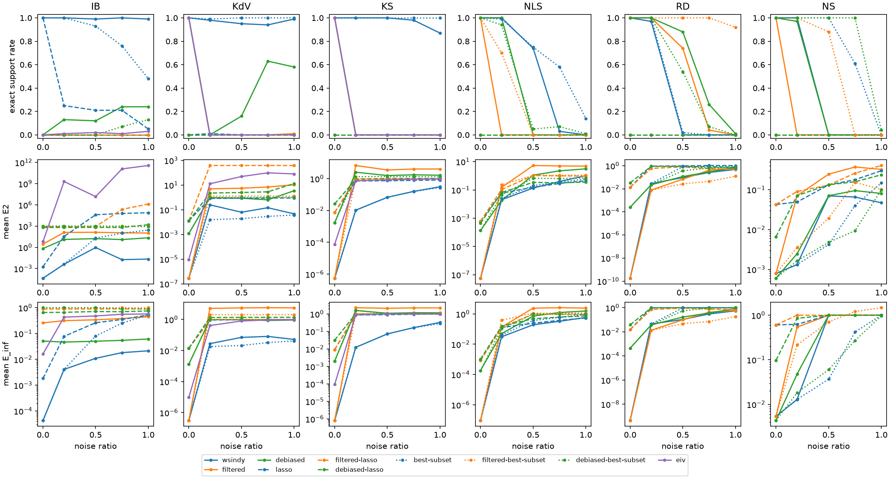

# WSINDy benchmark

Methods are defined in `run.py` (METHODS). TPR = TP/(TP+FN+FP); Exact = exact-support rate; E_inf = max relative error over true terms; E2 = relative coefficient L2 error; mean ± sample SD over trials, failures included. Seconds cover estimation, weak system and regression. Mean lambda / r: mean selected LASSO penalty, or best-subset sparsity bound r, per equation.

## Seeds

Noise seeds (trials) per noise level; noise ratios 0, 0.2, 0.5, 0.75, 1. Trial i uses the same seed for every method (pdes.trial_seed, root seed 0), so methods are compared on identical observations. At noise ratio 0 all trials coincide.

| Method | IB | KdV | KS | NLS | RD | NS |
| :--- | ---: | ---: | ---: | ---: | ---: | ---: |
| wsindy | 100 | 100 | 100 | 100 | 100 | 100 |
| filtered | 100 | 100 | 100 | 100 | 100 | 100 |
| debiased | 100 | 100 | 100 | 100 | 100 | 100 |
| lasso | 100 | 100 | 100 | 100 | 100 | 100 |
| filtered-lasso | 100 | 100 | 100 | 100 | 100 | 100 |
| debiased-lasso | 100 | 100 | 100 | 100 | 100 | 100 |
| best-subset | 100 | 100 | 100 | 100 | 100 | 100 |
| filtered-best-subset | 100 | 100 | 100 | 100 | 100 | 100 |
| debiased-best-subset | 100 | 100 | 100 | 100 | 100 | 100 |
| eiv | 100 | 100 | 100 | — | — | — |

## Summary

Exact-support rate (%) · mean E_inf, per noise ratio.

| PDE | Method | 0 | 0.2 | 0.5 | 0.75 | 1 |
| :--- | :--- | ---: | ---: | ---: | ---: | ---: |
| IB | wsindy | 100 · 4.3e-05 | 100 · 0.0041 | 99 · 0.011 | 100 · 0.018 | 99 · 0.021 |
| IB | filtered | 0 · 0.26 | 0 · 0.32 | 0 · 0.34 | 0 · 0.38 | 0 · 0.45 |
| IB | debiased | 0 · 0.051 | 13 · 0.047 | 12 · 0.05 | 24 · 0.055 | 24 · 0.061 |
| IB | lasso | 100 · 0.0018 | 25 · 0.078 | 21 · 0.26 | 21 · 0.35 | 5 · 0.53 |
| IB | filtered-lasso | 0 · 0.89 | 0 · 0.89 | 0 · 0.9 | 0 · 0.9 | 0 · 0.91 |
| IB | debiased-lasso | 0 · 0.66 | 0 · 0.66 | 0 · 0.71 | 0 · 0.7 | 0 · 0.75 |
| IB | best-subset | 100 · 4.3e-05 | 100 · 0.0041 | 93 · 0.08 | 76 · 0.25 | 48 · 0.53 |
| IB | filtered-best-subset | 0 · 1 | 0 · 1 | 0 · 1 | 0 · 1 | 0 · 1 |
| IB | debiased-best-subset | 0 · 1 | 0 · 1 | 0 · 1 | 7 · 0.93 | 13 · 0.88 |
| IB | eiv | 0 · 0.016 | 1 · 0.43 | 2 · 0.48 | 1 · 0.56 | 3 · 0.57 |
| KdV | wsindy | 100 · 3.1e-07 | 98 · 0.028 | 95 · 0.071 | 94 · 0.081 | 99 · 0.052 |
| KdV | filtered | 100 · 3.1e-07 | 0 · 5.2 | 0 · 5.6 | 0 · 5.8 | 1 · 5.7 |
| KdV | debiased | 100 · 0.0013 | 0 · 1 | 16 · 0.97 | 63 · 0.87 | 58 · 0.93 |
| KdV | lasso | 0 · 0.014 | 1 · 0.93 | 0 · 0.96 | 0 · 1 | 0 · 0.99 |
| KdV | filtered-lasso | 0 · 0.014 | 0 · 1 | 0 · 1 | 0 · 1 | 0 · 1 |
| KdV | debiased-lasso | 0 · 0.014 | 0 · 1.4 | 0 · 1.4 | 0 · 1.4 | 0 · 1.4 |
| KdV | best-subset | 100 · 3.1e-07 | 99 · 0.018 | 100 · 0.021 | 100 · 0.032 | 100 · 0.042 |
| KdV | filtered-best-subset | 100 · 3.1e-07 | 0 · 2.1 | 0 · 2.1 | 0 · 2.1 | 0 · 2.1 |
| KdV | debiased-best-subset | 100 · 0.0013 | 0 · 1 | 0 · 1 | 0 · 1 | 0 · 1 |
| KdV | eiv | 100 · 9.6e-06 | 0 · 0.41 | 0 · 0.8 | 0 · 0.94 | 0 · 0.97 |
| KS | wsindy | 100 · 8.2e-07 | 100 · 0.012 | 100 · 0.072 | 98 · 0.16 | 87 · 0.33 |
| KS | filtered | 100 · 8.2e-07 | 0 · 2.3 | 0 · 2.1 | 0 · 2.2 | 0 · 2.2 |
| KS | debiased | 100 · 0.002 | 0 · 1.6 | 0 · 1.1 | 0 · 1.2 | 0 · 1.2 |
| KS | lasso | 0 · 0.0092 | 0 · 0.87 | 0 · 0.9 | 0 · 0.96 | 0 · 0.98 |
| KS | filtered-lasso | 0 · 0.0092 | 0 · 1 | 0 · 1 | 0 · 1 | 0 · 1 |
| KS | debiased-lasso | 0 · 0.032 | 0 · 1 | 0 · 1 | 0 · 1 | 0 · 1 |
| KS | best-subset | 100 · 8.2e-07 | 100 · 0.012 | 100 · 0.072 | 100 · 0.16 | 100 · 0.28 |
| KS | filtered-best-subset | 100 · 8.2e-07 | 0 · 1 | 0 · 1 | 0 · 1 | 0 · 1.1 |
| KS | debiased-best-subset | 100 · 0.002 | 0 · 1.6 | 0 · 1 | 0 · 1 | 0 · 1 |
| KS | eiv | 100 · 9.3e-05 | 0 · 0.88 | 0 · 1 | 0 · 1 | 0 · 1 |
| NLS | wsindy | 100 · 9.3e-08 | 100 · 0.031 | 74 · 0.19 | 3 · 0.33 | 0 · 0.59 |
| NLS | filtered | 100 · 9.3e-08 | 0 · 0.13 | 0 · 2.4 | 0 · 2.6 | 0 · 2.4 |
| NLS | debiased | 100 · 0.00018 | 100 · 0.05 | 0 · 0.72 | 0 · 1.2 | 0 · 1.6 |
| NLS | lasso | 0 · 0.00085 | 0 · 0.13 | 0 · 0.24 | 0 · 0.38 | 0 · 0.54 |
| NLS | filtered-lasso | 0 · 0.00085 | 0 · 0.13 | 0 · 0.98 | 0 · 0.95 | 0 · 0.92 |
| NLS | debiased-lasso | 0 · 0.001 | 0 · 0.16 | 0 · 0.48 | 0 · 0.62 | 0 · 0.74 |
| NLS | best-subset | 100 · 9.3e-08 | 99 · 0.041 | 75 · 0.37 | 58 · 0.6 | 14 · 0.92 |
| NLS | filtered-best-subset | 100 · 9.3e-08 | 70 · 0.38 | 0 · 1.1 | 0 · 1.1 | 0 · 1.2 |
| NLS | debiased-best-subset | 100 · 0.00018 | 94 · 0.11 | 5 · 0.98 | 7 · 0.97 | 1 · 1 |
| RD | wsindy | 100 · 4.5e-10 | 97 · 0.044 | 0 · 0.11 | 0 · 0.3 | 0 · 0.55 |
| RD | filtered | 100 · 4.5e-10 | 100 · 0.014 | 74 · 0.1 | 4 · 0.43 | 0 · 0.6 |
| RD | debiased | 100 · 0.00044 | 100 · 0.037 | 88 · 0.17 | 26 · 0.36 | 1 · 0.84 |
| RD | lasso | 0 · 0.015 | 0 · 1 | 0 · 1 | 0 · 1 | 0 · 1 |
| RD | filtered-lasso | 0 · 0.015 | 0 · 0.72 | 0 · 0.93 | 0 · 0.77 | 0 · 0.7 |
| RD | debiased-lasso | 0 · 0.038 | 0 · 0.98 | 0 · 1 | 0 · 1 | 0 · 1 |
| RD | best-subset | 100 · 4.5e-10 | 100 · 0.045 | 2 · 0.98 | 0 · 1 | 0 · 1 |
| RD | filtered-best-subset | 100 · 4.5e-10 | 100 · 0.014 | 100 · 0.047 | 100 · 0.073 | 92 · 0.18 |
| RD | debiased-best-subset | 100 · 0.00044 | 100 · 0.037 | 54 · 0.55 | 7 · 0.95 | 0 · 1 |
| NS | wsindy | 100 · 0.0054 | 100 · 0.013 | 0 · 1 | 0 · 1 | 0 · 1 |
| NS | filtered | 100 · 0.0054 | 0 · 0.54 | 0 · 1 | 0 · 1 | 0 · 1 |
| NS | debiased | 100 · 0.0044 | 97 · 0.048 | 0 · 1 | 0 · 1 | 0 · 1 |
| NS | lasso | 0 · 0.61 | 0 · 0.62 | 0 · 1 | 0 · 1 | 0 · 1 |
| NS | filtered-lasso | 0 · 0.61 | 0 · 1 | 0 · 1 | 0 · 1 | 0 · 1 |
| NS | debiased-lasso | 0 · 0.098 | 0 · 0.85 | 0 · 1 | 0 · 1 | 0 · 1 |
| NS | best-subset | 100 · 0.0054 | 100 · 0.013 | 100 · 0.037 | 61 · 0.42 | 0 · 1 |
| NS | filtered-best-subset | 100 · 0.0054 | 100 · 0.22 | 88 · 0.71 | 0 · 1.2 | 0 · 1.5 |
| NS | debiased-best-subset | 100 · 0.0044 | 100 · 0.018 | 100 · 0.06 | 100 · 0.27 | 4 · 0.97 |

## IB

`u_t = -0.5 (u^2)_x`  

| Data U | X (K x J) | Y (K x E) | beta (J x E) | True nonzeros |
| :--- | :--- | :--- | :--- | :--- |
| 256 x 256 grid; components u | 784 x 43 | 784 x 1 | 43 x 1 | 1 of 43 (u_t: 1) |

K = weak equations (test-function centers), J = dictionary terms, E = equations. Test functions `Tests(m=(60, 60), p=(7, 7), s=(5, 5), shape='poly', tau=1e-10, tau_hat=2.0)`.

### Noise ratio 0

| Method | Trials | Exact | TPR | E_inf | E2 | Mean seconds | Mean lambda / r |
| :--- | ---: | ---: | ---: | ---: | ---: | ---: | :--- |
| wsindy | 100 | 100.0% | 1 ± 0 | 4.30846e-05 ± 0 | 4.30846e-05 ± 0 | 0.0252 | — |
| filtered | 100 | 0.0% | 0.2 ± 5.58e-17 | 0.258283 ± 5.58e-17 | 2.88961 ± 4.46e-16 | 0.0215 | — |
| debiased | 100 | 0.0% | 0.2 ± 5.58e-17 | 0.0511407 ± 1.39e-17 | 0.686371 ± 1.12e-16 | 0.0338 | — |
| lasso | 100 | 100.0% | 1 ± 0 | 0.00183166 ± 0 | 0.00183166 ± 0 | 0.0337 | lambda_u=0.001789 |
| filtered-lasso | 100 | 0.0% | 0.5 ± 0 | 0.890185 ± 1.12e-16 | 870.704 ± 0 | 0.0258 | lambda_u=0.01517 |
| debiased-lasso | 100 | 0.0% | 0.5 ± 0 | 0.656464 ± 1.12e-16 | 645.186 ± 0 | 0.0672 | lambda_u=0.01144 |
| best-subset | 100 | 100.0% | 1 ± 0 | 4.30846e-05 ± 0 | 4.30846e-05 ± 0 | 0.0246 | r_u=1 |
| filtered-best-subset | 100 | 0.0% | 0 ± 0 | 1 ± 0 | 995.458 ± 0 | 0.0442 | r_u=1 |
| debiased-best-subset | 100 | 0.0% | 0 ± 0 | 1 ± 0 | 999.372 ± 2.29e-13 | 0.0723 | r_u=1 |
| eiv | 100 | 0.0% | 0.333333 ± 1.12e-16 | 0.0163045 ± 3.49e-18 | 6.51529 ± 2.68e-15 | 8.77 | — |

### Noise ratio 0.2

| Method | Trials | Exact | TPR | E_inf | E2 | Mean seconds | Mean lambda / r |
| :--- | ---: | ---: | ---: | ---: | ---: | ---: | :--- |
| wsindy | 100 | 100.0% | 1 ± 0 | 0.00408295 ± 0.00318 | 0.00408295 ± 0.00318 | 0.0258 | — |
| filtered | 100 | 0.0% | 0.170988 ± 0.0325 | 0.315689 ± 0.209 | 128.567 ± 263 | 0.0216 | — |
| debiased | 100 | 13.0% | 0.376095 ± 0.253 | 0.0467351 ± 0.0256 | 13.2255 ± 13.7 | 0.0345 | — |
| lasso | 100 | 25.0% | 0.625 ± 0.218 | 0.0778663 ± 0.0679 | 34.6959 ± 44.8 | 0.0384 | lambda_u=0.01324 |
| filtered-lasso | 100 | 0.0% | 0.5 ± 0 | 0.891891 ± 0.00943 | 870.693 ± 10.7 | 0.0244 | lambda_u=0.01762 |
| debiased-lasso | 100 | 0.0% | 0.5 ± 0 | 0.663719 ± 0.0316 | 643.642 ± 31.1 | 0.0647 | lambda_u=0.02104 |
| best-subset | 100 | 100.0% | 1 ± 0 | 0.00408295 ± 0.00318 | 0.00408295 ± 0.00318 | 0.0332 | r_u=1 |
| filtered-best-subset | 100 | 0.0% | 0 ± 0 | 1 ± 0 | 996.239 ± 4.38 | 0.0449 | r_u=1 |
| debiased-best-subset | 100 | 0.0% | 0 ± 0 | 1 ± 0 | 1000.3 ± 6.87 | 0.0744 | r_u=1 |
| eiv | 100 | 1.0% | 0.27023 ± 0.15 | 0.431558 ± 0.288 | 2.02694e+09 ± 2e+10 | 7.92 | — |

### Noise ratio 0.5

| Method | Trials | Exact | TPR | E_inf | E2 | Mean seconds | Mean lambda / r |
| :--- | ---: | ---: | ---: | ---: | ---: | ---: | :--- |
| wsindy | 100 | 99.0% | 0.991111 ± 0.0889 | 0.0109775 ± 0.0094 | 0.940651 ± 9.3 | 0.025 | — |
| filtered | 100 | 0.0% | 0.168206 ± 0.0387 | 0.340184 ± 0.278 | 135.368 ± 268 | 0.0211 | — |
| debiased | 100 | 12.0% | 0.381167 ± 0.247 | 0.0502907 ± 0.0319 | 17.1055 ± 18.6 | 0.0337 | — |
| lasso | 100 | 21.0% | 0.561667 ± 0.261 | 0.262172 ± 0.278 | 40544 ± 4.03e+05 | 0.039 | lambda_u=0.02681 |
| filtered-lasso | 100 | 0.0% | 0.491667 ± 0.0365 | 0.89946 ± 0.0208 | 871.311 ± 26.3 | 0.0238 | lambda_u=0.0236 |
| debiased-lasso | 100 | 0.0% | 0.468333 ± 0.113 | 0.711842 ± 0.104 | 667.07 ± 82.4 | 0.0648 | lambda_u=0.03167 |
| best-subset | 100 | 93.0% | 0.93 ± 0.256 | 0.0802429 ± 0.254 | 20.0816 ± 141 | 0.0338 | r_u=1 |
| filtered-best-subset | 100 | 0.0% | 0 ± 0 | 1 ± 0 | 996.275 ± 13.1 | 0.046 | r_u=1 |
| debiased-best-subset | 100 | 0.0% | 0 ± 0 | 1 ± 0 | 999.908 ± 17.6 | 0.0767 | r_u=1 |
| eiv | 100 | 2.0% | 0.284353 ± 0.176 | 0.479534 ± 0.29 | 1.50187e+07 ± 1.09e+08 | 7.73 | — |

### Noise ratio 0.75

| Method | Trials | Exact | TPR | E_inf | E2 | Mean seconds | Mean lambda / r |
| :--- | ---: | ---: | ---: | ---: | ---: | ---: | :--- |
| wsindy | 100 | 100.0% | 1 ± 0 | 0.0182255 ± 0.0129 | 0.0182255 ± 0.0129 | 0.0237 | — |
| filtered | 100 | 0.0% | 0.17306 ± 0.0415 | 0.38071 ± 0.337 | 114.619 ± 260 | 0.0212 | — |
| debiased | 100 | 24.0% | 0.491667 ± 0.302 | 0.0545264 ± 0.0391 | 12.6103 ± 21.5 | 0.0361 | — |
| lasso | 100 | 21.0% | 0.540833 ± 0.272 | 0.349902 ± 0.268 | 61863.4 ± 6.16e+05 | 0.04 | lambda_u=0.04173 |
| filtered-lasso | 100 | 0.0% | 0.474167 ± 0.0623 | 0.898433 ± 0.033 | 232531 ± 2.32e+06 | 0.0258 | lambda_u=0.02724 |
| debiased-lasso | 100 | 0.0% | 0.475833 ± 0.0733 | 0.700693 ± 0.122 | 654.879 ± 121 | 0.0629 | lambda_u=0.03895 |
| best-subset | 100 | 76.0% | 0.76 ± 0.429 | 0.253209 ± 0.422 | 99.8672 ± 301 | 0.034 | r_u=1 |
| filtered-best-subset | 100 | 0.0% | 0 ± 0 | 1 ± 0 | 992.486 ± 18.4 | 0.0444 | r_u=1 |
| debiased-best-subset | 100 | 7.0% | 0.07 ± 0.256 | 0.932 ± 0.249 | 927.799 ± 257 | 0.0774 | r_u=1 |
| eiv | 100 | 1.0% | 0.283994 ± 0.172 | 0.558799 ± 0.277 | 1.22638e+11 ± 1.22e+12 | 8.2 | — |

### Noise ratio 1

| Method | Trials | Exact | TPR | E_inf | E2 | Mean seconds | Mean lambda / r |
| :--- | ---: | ---: | ---: | ---: | ---: | ---: | :--- |
| wsindy | 100 | 99.0% | 0.995 ± 0.05 | 0.0214272 ± 0.0151 | 0.0219393 ± 0.016 | 0.0248 | — |
| filtered | 100 | 0.0% | 0.18081 ± 0.0423 | 0.449489 ± 0.433 | 105.431 ± 237 | 0.0203 | — |
| debiased | 100 | 24.0% | 0.49 ± 0.304 | 0.0614507 ± 0.103 | 22.3852 ± 94.1 | 0.0346 | — |
| lasso | 100 | 5.0% | 0.416667 ± 0.203 | 0.526774 ± 0.286 | 77815.3 ± 7.72e+05 | 0.041 | lambda_u=0.04705 |
| filtered-lasso | 100 | 0.0% | 0.446667 ± 0.108 | 0.905774 ± 0.0416 | 1.32148e+06 ± 5.85e+06 | 0.0328 | lambda_u=0.02975 |
| debiased-lasso | 100 | 0.0% | 0.415 ± 0.17 | 0.751486 ± 0.166 | 1565.95 ± 4.8e+03 | 0.0639 | lambda_u=0.04624 |
| best-subset | 100 | 48.0% | 0.48 ± 0.502 | 0.529228 ± 0.493 | 277.539 ± 447 | 0.0338 | r_u=1 |
| filtered-best-subset | 100 | 0.0% | 0 ± 0 | 1 ± 0 | 992.493 ± 23.5 | 0.0447 | r_u=1 |
| debiased-best-subset | 100 | 13.0% | 0.13 ± 0.338 | 0.875027 ± 0.325 | 866.306 ± 338 | 0.0763 | r_u=1 |
| eiv | 100 | 3.0% | 0.314513 ± 0.197 | 0.573567 ± 0.285 | 3.73013e+11 ± 3.73e+12 | 7.25 | — |

## KdV

`u_t = -0.5 (u^2)_x - u_xxx`  

| Data U | X (K x J) | Y (K x E) | beta (J x E) | True nonzeros |
| :--- | :--- | :--- | :--- | :--- |
| 400 x 601 grid; components u | 1443 x 43 | 1443 x 1 | 43 x 1 | 2 of 43 (u_t: 2) |

K = weak equations (test-function centers), J = dictionary terms, E = equations. Test functions `Tests(m=(45, 80), p=(8, 7), s=(8, 12), shape='poly', tau=1e-10, tau_hat=2.0)`.

### Noise ratio 0

| Method | Trials | Exact | TPR | E_inf | E2 | Mean seconds | Mean lambda / r |
| :--- | ---: | ---: | ---: | ---: | ---: | ---: | :--- |
| wsindy | 100 | 100.0% | 1 ± 0 | 3.13515e-07 ± 0 | 2.84321e-07 ± 1.06e-22 | 0.071 | — |
| filtered | 100 | 100.0% | 1 ± 0 | 3.13515e-07 ± 0 | 2.84321e-07 ± 1.06e-22 | 0.0602 | — |
| debiased | 100 | 100.0% | 1 ± 0 | 0.00132425 ± 0 | 0.00120635 ± 0 | 0.149 | — |
| lasso | 100 | 0.0% | 0.5 ± 0 | 0.0139033 ± 5.23e-18 | 0.0124488 ± 5.23e-18 | 0.11 | lambda_u=9.987e-05 |
| filtered-lasso | 100 | 0.0% | 0.5 ± 0 | 0.0139033 ± 5.23e-18 | 0.0124488 ± 5.23e-18 | 0.0642 | lambda_u=9.987e-05 |
| debiased-lasso | 100 | 0.0% | 0.5 ± 0 | 0.0141497 ± 0 | 0.0126812 ± 0 | 0.24 | lambda_u=9.987e-05 |
| best-subset | 100 | 100.0% | 1 ± 0 | 3.13515e-07 ± 0 | 2.84321e-07 ± 5.32e-23 | 0.0704 | r_u=2 |
| filtered-best-subset | 100 | 100.0% | 1 ± 0 | 3.13515e-07 ± 0 | 2.84321e-07 ± 5.32e-23 | 0.0969 | r_u=2 |
| debiased-best-subset | 100 | 100.0% | 1 ± 0 | 0.00132425 ± 0 | 0.00120635 ± 0 | 0.181 | r_u=2 |
| eiv | 100 | 100.0% | 1 ± 0 | 9.56083e-06 ± 0 | 9.15543e-06 ± 3.41e-21 | 5.91 | — |

### Noise ratio 0.2

| Method | Trials | Exact | TPR | E_inf | E2 | Mean seconds | Mean lambda / r |
| :--- | ---: | ---: | ---: | ---: | ---: | ---: | :--- |
| wsindy | 100 | 98.0% | 0.988333 ± 0.0829 | 0.0277983 ± 0.14 | 0.250095 ± 2.34 | 0.0776 | — |
| filtered | 100 | 0.0% | 0.457302 ± 0.0955 | 5.19599 ± 1.6 | 4.97227 ± 1.8 | 0.0754 | — |
| debiased | 100 | 0.0% | 0.5 ± 0 | 1 ± 0 | 0.940936 ± 0.000335 | 0.15 | — |
| lasso | 100 | 1.0% | 0.286667 ± 0.129 | 0.927385 ± 0.248 | 0.830413 ± 0.222 | 0.117 | lambda_u=0.006917 |
| filtered-lasso | 100 | 0.0% | 0.333333 ± 1.12e-16 | 1 ± 0 | 385.212 ± 0.817 | 0.0686 | lambda_u=0.03004 |
| debiased-lasso | 100 | 0.0% | 0.656667 ± 0.0571 | 1.3502 ± 0.0882 | 2.25696 ± 11.6 | 0.25 | lambda_u=0.01018 |
| best-subset | 100 | 99.0% | 0.993333 ± 0.0667 | 0.017761 ± 0.0994 | 0.0158931 ± 0.0889 | 0.102 | r_u=2 |
| filtered-best-subset | 100 | 0.0% | 0.333333 ± 1.12e-16 | 2.05373 ± 0.00472 | 1.28202 ± 0.00151 | 0.162 | r_u=2 |
| debiased-best-subset | 100 | 0.0% | 0 ± 0 | 1 ± 0 | 1 ± 1.63e-08 | 0.276 | r_u=2 |
| eiv | 100 | 0.0% | 0.341316 ± 0.0789 | 0.40838 ± 0.145 | 12.7341 ± 21.3 | 1.38 | — |

### Noise ratio 0.5

| Method | Trials | Exact | TPR | E_inf | E2 | Mean seconds | Mean lambda / r |
| :--- | ---: | ---: | ---: | ---: | ---: | ---: | :--- |
| wsindy | 100 | 95.0% | 0.971667 ± 0.125 | 0.0706185 ± 0.215 | 0.0631837 ± 0.192 | 0.0783 | — |
| filtered | 100 | 0.0% | 0.44746 ± 0.107 | 5.61902 ± 1.09 | 5.52692 ± 1.53 | 0.0702 | — |
| debiased | 100 | 16.0% | 0.58 ± 0.184 | 0.966761 ± 0.0767 | 0.86442 ± 0.177 | 0.149 | — |
| lasso | 100 | 0.0% | 0.275 ± 0.0995 | 0.958036 ± 0.168 | 0.857904 ± 0.15 | 0.119 | lambda_u=0.007107 |
| filtered-lasso | 100 | 0.0% | 0.333333 ± 1.12e-16 | 1 ± 0 | 384.979 ± 2.34 | 0.0769 | lambda_u=0.02985 |
| debiased-lasso | 100 | 0.0% | 0.628333 ± 0.0816 | 1.37175 ± 0.105 | 2.48697 ± 10.9 | 0.241 | lambda_u=0.009739 |
| best-subset | 100 | 100.0% | 1 ± 0 | 0.0213939 ± 0.0164 | 0.0191497 ± 0.0147 | 0.102 | r_u=2 |
| filtered-best-subset | 100 | 0.0% | 0.333333 ± 1.12e-16 | 2.05343 ± 0.0114 | 1.28192 ± 0.00366 | 0.147 | r_u=2 |
| debiased-best-subset | 100 | 0.0% | 0 ± 0 | 1 ± 0 | 1 ± 4.43e-08 | 0.292 | r_u=2 |
| eiv | 100 | 0.0% | 0.261014 ± 0.102 | 0.802369 ± 0.208 | 49.305 ± 141 | 1.36 | — |

### Noise ratio 0.75

| Method | Trials | Exact | TPR | E_inf | E2 | Mean seconds | Mean lambda / r |
| :--- | ---: | ---: | ---: | ---: | ---: | ---: | :--- |
| wsindy | 100 | 94.0% | 0.971667 ± 0.114 | 0.0813984 ± 0.213 | 0.146024 ± 0.751 | 0.0756 | — |
| filtered | 100 | 0.0% | 0.417437 ± 0.114 | 5.75482 ± 0.741 | 7.00888 ± 11.1 | 0.0707 | — |
| debiased | 100 | 63.0% | 0.815 ± 0.243 | 0.865637 ± 0.104 | 0.6377 ± 0.236 | 0.151 | — |
| lasso | 100 | 0.0% | 0.265833 ± 0.0498 | 0.995386 ± 0.0461 | 0.891908 ± 0.0414 | 0.12 | lambda_u=0.01042 |
| filtered-lasso | 100 | 0.0% | 0.333333 ± 1.12e-16 | 1 ± 0 | 384.765 ± 3.65 | 0.0788 | lambda_u=0.02977 |
| debiased-lasso | 100 | 0.0% | 0.605667 ± 0.0823 | 1.37852 ± 0.119 | 2.83438 ± 6.44 | 0.235 | lambda_u=0.009594 |
| best-subset | 100 | 100.0% | 1 ± 0 | 0.0324244 ± 0.0241 | 0.0290362 ± 0.0215 | 0.107 | r_u=2 |
| filtered-best-subset | 100 | 0.0% | 0.333333 ± 1.12e-16 | 2.05216 ± 0.0141 | 1.28152 ± 0.00452 | 0.148 | r_u=2 |
| debiased-best-subset | 100 | 0.0% | 0 ± 0 | 1 ± 0 | 1 ± 3.26e-07 | 0.287 | r_u=2 |
| eiv | 100 | 0.0% | 0.196936 ± 0.0725 | 0.940965 ± 0.128 | 98.046 ± 380 | 1.28 | — |

### Noise ratio 1

| Method | Trials | Exact | TPR | E_inf | E2 | Mean seconds | Mean lambda / r |
| :--- | ---: | ---: | ---: | ---: | ---: | ---: | :--- |
| wsindy | 100 | 99.0% | 0.995 ± 0.05 | 0.0520222 ± 0.103 | 0.0465661 ± 0.0917 | 0.0759 | — |
| filtered | 100 | 1.0% | 0.397802 ± 0.142 | 5.66193 ± 1.24 | 10.5294 ± 22 | 0.0708 | — |
| debiased | 100 | 58.0% | 0.789 ± 0.249 | 0.925974 ± 0.52 | 3.48861 ± 28.3 | 0.153 | — |
| lasso | 100 | 0.0% | 0.2975 ± 0.0559 | 0.994591 ± 0.0541 | 0.892453 ± 0.0487 | 0.126 | lambda_u=0.01778 |
| filtered-lasso | 100 | 0.0% | 0.333333 ± 1.12e-16 | 1 ± 0 | 383.727 ± 4.36 | 0.0811 | lambda_u=0.02993 |
| debiased-lasso | 100 | 0.0% | 0.562619 ± 0.123 | 1.38514 ± 0.208 | 13.3401 ± 34.7 | 0.219 | lambda_u=0.009654 |
| best-subset | 100 | 100.0% | 1 ± 0 | 0.0421661 ± 0.0368 | 0.0377484 ± 0.0329 | 0.109 | r_u=2 |
| filtered-best-subset | 100 | 0.0% | 0.333333 ± 1.12e-16 | 2.06729 ± 0.0823 | 1.2866 ± 0.0274 | 0.148 | r_u=2 |
| debiased-best-subset | 100 | 0.0% | 0 ± 0 | 1 ± 0 | 1 ± 7.07e-07 | 0.283 | r_u=2 |
| eiv | 100 | 0.0% | 0.197941 ± 0.0871 | 0.971565 ± 0.106 | 79.7522 ± 354 | 1.24 | — |

## KS

`u_t = -0.5 (u^2)_x - u_xx - u_xxxx`  

| Data U | X (K x J) | Y (K x E) | beta (J x E) | True nonzeros |
| :--- | :--- | :--- | :--- | :--- |
| 256 x 301 grid; components u | 1806 x 43 | 1806 x 1 | 43 x 1 | 3 of 43 (u_t: 3) |

K = weak equations (test-function centers), J = dictionary terms, E = equations. Test functions `Tests(m=(23, 22), p=(10, 10), s=(5, 6), shape='poly', tau=1e-10, tau_hat=2.0)`.

### Noise ratio 0

| Method | Trials | Exact | TPR | E_inf | E2 | Mean seconds | Mean lambda / r |
| :--- | ---: | ---: | ---: | ---: | ---: | ---: | :--- |
| wsindy | 100 | 100.0% | 1 ± 0 | 8.18316e-07 ± 0 | 5.54625e-07 ± 0 | 0.0178 | — |
| filtered | 100 | 100.0% | 1 ± 0 | 8.18316e-07 ± 0 | 5.54625e-07 ± 0 | 0.0182 | — |
| debiased | 100 | 100.0% | 1 ± 0 | 0.00204349 ± 0 | 0.0017033 ± 6.54e-19 | 0.0554 | — |
| lasso | 100 | 0.0% | 0.272727 ± 5.58e-17 | 0.00920226 ± 0 | 0.00759012 ± 2.62e-18 | 0.052 | lambda_u=5.794e-05 |
| filtered-lasso | 100 | 0.0% | 0.272727 ± 5.58e-17 | 0.00920226 ± 0 | 0.00759012 ± 2.62e-18 | 0.0257 | lambda_u=5.794e-05 |
| debiased-lasso | 100 | 0.0% | 0.333333 ± 1.12e-16 | 0.0318826 ± 6.97e-18 | 0.0261194 ± 0 | 0.0763 | lambda_u=0.0001482 |
| best-subset | 100 | 100.0% | 1 ± 0 | 8.18316e-07 ± 0 | 5.54625e-07 ± 0 | 0.0294 | r_u=3 |
| filtered-best-subset | 100 | 100.0% | 1 ± 0 | 8.18316e-07 ± 0 | 5.54625e-07 ± 0 | 0.0364 | r_u=3 |
| debiased-best-subset | 100 | 100.0% | 1 ± 0 | 0.00204349 ± 0 | 0.0017033 ± 6.54e-19 | 0.0662 | r_u=3 |
| eiv | 100 | 100.0% | 1 ± 0 | 9.27835e-05 ± 0 | 7.54185e-05 ± 1.36e-20 | 2.1 | — |

### Noise ratio 0.2

| Method | Trials | Exact | TPR | E_inf | E2 | Mean seconds | Mean lambda / r |
| :--- | ---: | ---: | ---: | ---: | ---: | ---: | :--- |
| wsindy | 100 | 100.0% | 1 ± 0 | 0.0122972 ± 0.00551 | 0.0104377 ± 0.0056 | 0.0428 | — |
| filtered | 100 | 0.0% | 0.0723575 ± 0.0196 | 2.26388 ± 0.339 | 6.69491 ± 1.47 | 0.038 | — |
| debiased | 100 | 0.0% | 0.142857 ± 5.58e-17 | 1.58211 ± 0.0439 | 2.52829 ± 0.131 | 0.0736 | — |
| lasso | 100 | 0.0% | 0.285054 ± 0.0251 | 0.866745 ± 0.257 | 0.711172 ± 0.211 | 0.0547 | lambda_u=0.01035 |
| filtered-lasso | 100 | 0.0% | 0.391619 ± 0.0277 | 1 ± 0 | 0.977837 ± 0.00175 | 0.0343 | lambda_u=0.03012 |
| debiased-lasso | 100 | 0.0% | 0.432714 ± 0.0712 | 1 ± 0 | 0.883757 ± 0.00443 | 0.0796 | lambda_u=0.02943 |
| best-subset | 100 | 100.0% | 1 ± 0 | 0.0122972 ± 0.00551 | 0.0104377 ± 0.0056 | 0.0318 | r_u=3 |
| filtered-best-subset | 100 | 0.0% | 0.5 ± 0 | 1 ± 0 | 0.959817 ± 0.000292 | 0.302 | r_u=3 |
| debiased-best-subset | 100 | 0.0% | 0.5 ± 0 | 1.60138 ± 0.00579 | 1.3253 ± 0.00441 | 0.091 | r_u=3 |
| eiv | 100 | 0.0% | 0.168204 ± 0.0542 | 0.880716 ± 0.155 | 0.728973 ± 0.128 | 1.86 | — |

### Noise ratio 0.5

| Method | Trials | Exact | TPR | E_inf | E2 | Mean seconds | Mean lambda / r |
| :--- | ---: | ---: | ---: | ---: | ---: | ---: | :--- |
| wsindy | 100 | 100.0% | 1 ± 0 | 0.0722229 ± 0.0168 | 0.0670009 ± 0.0173 | 0.0454 | — |
| filtered | 100 | 0.0% | 0.0992914 ± 0.0272 | 2.10143 ± 0.407 | 3.50823 ± 2.15 | 0.0374 | — |
| debiased | 100 | 0.0% | 0.010285 ± 0.033 | 1.09014 ± 0.275 | 1.56831 ± 0.839 | 0.0699 | — |
| lasso | 100 | 0.0% | 0.262917 ± 0.0333 | 0.903213 ± 0.203 | 0.737055 ± 0.166 | 0.0567 | lambda_u=0.01124 |
| filtered-lasso | 100 | 0.0% | 0.00666667 ± 0.0328 | 1 ± 0 | 0.999641 ± 0.00198 | 0.0296 | lambda_u=0.05899 |
| debiased-lasso | 100 | 0.0% | 0.168167 ± 0.0262 | 1 ± 0 | 1.03928 ± 0.0148 | 0.0776 | lambda_u=0.0574 |
| best-subset | 100 | 100.0% | 1 ± 0 | 0.0722229 ± 0.0168 | 0.0670009 ± 0.0173 | 0.0368 | r_u=3 |
| filtered-best-subset | 100 | 0.0% | 0.198 ± 0.02 | 1.02587 ± 0.0781 | 0.975942 ± 0.0204 | 0.124 | r_u=3 |
| debiased-best-subset | 100 | 0.0% | 0 ± 0 | 1 ± 0 | 1.36384 ± 0.0213 | 0.129 | r_u=3 |
| eiv | 100 | 0.0% | 0.165598 ± 0.0279 | 0.997889 ± 0.015 | 0.841825 ± 0.0324 | 1.6 | — |

### Noise ratio 0.75

| Method | Trials | Exact | TPR | E_inf | E2 | Mean seconds | Mean lambda / r |
| :--- | ---: | ---: | ---: | ---: | ---: | ---: | :--- |
| wsindy | 100 | 98.0% | 0.995 ± 0.0352 | 0.164424 ± 0.0274 | 0.15789 ± 0.0246 | 0.0505 | — |
| filtered | 100 | 0.0% | 0.0895441 ± 0.0297 | 2.20814 ± 0.423 | 4.02027 ± 2.05 | 0.0369 | — |
| debiased | 100 | 0.0% | 0.0210995 ± 0.0425 | 1.17108 ± 0.337 | 1.74051 ± 0.965 | 0.0691 | — |
| lasso | 100 | 0.0% | 0.26944 ± 0.0447 | 0.956166 ± 0.16 | 0.780472 ± 0.126 | 0.047 | lambda_u=0.01523 |
| filtered-lasso | 100 | 0.0% | 0.0317143 ± 0.0732 | 1.00071 ± 0.00502 | 0.998044 ± 0.00451 | 0.0288 | lambda_u=0.05513 |
| debiased-lasso | 100 | 0.0% | 0.183726 ± 0.0311 | 1 ± 0 | 1.02612 ± 0.0097 | 0.0785 | lambda_u=0.06212 |
| best-subset | 100 | 100.0% | 1 ± 0 | 0.162706 ± 0.0208 | 0.156629 ± 0.0209 | 0.0415 | r_u=3 |
| filtered-best-subset | 100 | 0.0% | 0.19 ± 0.0438 | 1.02341 ± 0.0751 | 0.976731 ± 0.0204 | 0.145 | r_u=3 |
| debiased-best-subset | 100 | 0.0% | 0 ± 0 | 1 ± 0 | 1.33543 ± 0.0313 | 0.135 | r_u=3 |
| eiv | 100 | 0.0% | 0.155113 ± 0.0537 | 0.999636 ± 0.00244 | 0.912234 ± 0.0409 | 1.53 | — |

### Noise ratio 1

| Method | Trials | Exact | TPR | E_inf | E2 | Mean seconds | Mean lambda / r |
| :--- | ---: | ---: | ---: | ---: | ---: | ---: | :--- |
| wsindy | 100 | 87.0% | 0.943357 ± 0.158 | 0.326388 ± 0.222 | 0.309675 ± 0.172 | 0.0494 | — |
| filtered | 100 | 0.0% | 0.090529 ± 0.0351 | 2.20801 ± 0.422 | 4.03428 ± 2.03 | 0.0375 | — |
| debiased | 100 | 0.0% | 0.0206849 ± 0.0409 | 1.16301 ± 0.326 | 1.63737 ± 0.909 | 0.0678 | — |
| lasso | 100 | 0.0% | 0.289096 ± 0.0508 | 0.979625 ± 0.104 | 0.816684 ± 0.0799 | 0.0471 | lambda_u=0.02046 |
| filtered-lasso | 100 | 0.0% | 0.0248095 ± 0.0665 | 1.00147 ± 0.00871 | 0.998598 ± 0.00387 | 0.0289 | lambda_u=0.05461 |
| debiased-lasso | 100 | 0.0% | 0.195155 ± 0.037 | 1 ± 0 | 1.01789 ± 0.00999 | 0.0782 | lambda_u=0.06243 |
| best-subset | 100 | 100.0% | 1 ± 0 | 0.281163 ± 0.028 | 0.272792 ± 0.0273 | 0.051 | r_u=3 |
| filtered-best-subset | 100 | 0.0% | 0.174 ± 0.0676 | 1.06854 ± 0.117 | 0.991017 ± 0.0297 | 0.17 | r_u=3 |
| debiased-best-subset | 100 | 0.0% | 0.004 ± 0.0281 | 1 ± 0 | 1.30088 ± 0.0486 | 0.152 | r_u=3 |
| eiv | 100 | 0.0% | 0.136806 ± 0.0545 | 0.999209 ± 0.00429 | 0.966407 ± 0.0197 | 1.42 | — |

## NLS

`u_t = 0.5 v_xx + u^2 v + v^3`  
`v_t = -0.5 u_xx - u v^2 - u^3`  

| Data U | X (K x J) | Y (K x E) | beta (J x E) | True nonzeros |
| :--- | :--- | :--- | :--- | :--- |
| 256 x 251 grid; components u, v | 1804 x 190 | 1804 x 2 | 190 x 2 | 6 of 380 (u_t: 3, v_t: 3) |

K = weak equations (test-function centers), J = dictionary terms, E = equations. Test functions `Tests(m=(19, 25), p=(11, 10), s=(5, 5), shape='poly', tau=1e-10, tau_hat=2.0)`.

### Noise ratio 0

| Method | Trials | Exact | TPR | E_inf | E2 | Mean seconds | Mean lambda / r |
| :--- | ---: | ---: | ---: | ---: | ---: | ---: | :--- |
| wsindy | 100 | 100.0% | 1 ± 0 | 9.28616e-08 ± 0 | 5.60489e-08 ± 6.65e-24 | 0.0795 | — |
| filtered | 100 | 100.0% | 1 ± 0 | 9.28616e-08 ± 0 | 5.60489e-08 ± 6.65e-24 | 0.0841 | — |
| debiased | 100 | 100.0% | 1 ± 0 | 0.000184956 ± 0 | 0.000133683 ± 0 | 0.175 | — |
| lasso | 100 | 0.0% | 0.5 ± 0 | 0.00084906 ± 0 | 0.000618916 ± 1.09e-19 | 0.208 | lambda_u=9.083e-05, lambda_v=9.087e-05 |
| filtered-lasso | 100 | 0.0% | 0.5 ± 0 | 0.00084906 ± 0 | 0.000618916 ± 1.09e-19 | 0.107 | lambda_u=9.083e-05, lambda_v=9.087e-05 |
| debiased-lasso | 100 | 0.0% | 0.6 ± 0 | 0.00103565 ± 0 | 0.000438667 ± 0 | 0.293 | lambda_u=0.0001094, lambda_v=0.0001094 |
| best-subset | 100 | 100.0% | 1 ± 0 | 9.28616e-08 ± 0 | 5.60489e-08 ± 6.65e-24 | 0.309 | r_u=3, r_v=3 |
| filtered-best-subset | 100 | 100.0% | 1 ± 0 | 9.28616e-08 ± 0 | 5.60489e-08 ± 6.65e-24 | 0.383 | r_u=3, r_v=3 |
| debiased-best-subset | 100 | 100.0% | 1 ± 0 | 0.000184956 ± 0 | 0.000133683 ± 0 | 0.849 | r_u=3, r_v=3 |

### Noise ratio 0.2

| Method | Trials | Exact | TPR | E_inf | E2 | Mean seconds | Mean lambda / r |
| :--- | ---: | ---: | ---: | ---: | ---: | ---: | :--- |
| wsindy | 100 | 100.0% | 1 ± 0 | 0.031011 ± 0.00358 | 0.0200444 ± 0.00267 | 0.568 | — |
| filtered | 100 | 0.0% | 0.662469 ± 0.0953 | 0.134777 ± 0.0371 | 0.149227 ± 0.0358 | 0.548 | — |
| debiased | 100 | 100.0% | 1 ± 0 | 0.0501792 ± 0.00449 | 0.0182245 ± 0.00231 | 0.931 | — |
| lasso | 100 | 0.0% | 0.359777 ± 0.0326 | 0.126324 ± 0.0103 | 0.0593371 ± 0.00781 | 0.201 | lambda_u=0.006863, lambda_v=0.006866 |
| filtered-lasso | 100 | 0.0% | 0.274269 ± 0.0301 | 0.128724 ± 0.0133 | 0.105388 ± 0.00935 | 0.126 | lambda_u=0.007182, lambda_v=0.007184 |
| debiased-lasso | 100 | 0.0% | 0.29735 ± 0.042 | 0.155957 ± 0.0233 | 0.0659959 ± 0.0133 | 0.338 | lambda_u=0.006501, lambda_v=0.006503 |
| best-subset | 100 | 99.0% | 0.997143 ± 0.0286 | 0.0406566 ± 0.097 | 0.0246631 ± 0.0464 | 13.7 | r_u=3, r_v=3 |
| filtered-best-subset | 100 | 70.0% | 0.889524 ± 0.183 | 0.382968 ± 0.406 | 0.230257 ± 0.207 | 29.8 | r_u=3, r_v=3 |
| debiased-best-subset | 100 | 94.0% | 0.982857 ± 0.0682 | 0.107004 ± 0.227 | 0.0439814 ± 0.104 | 24.9 | r_u=3, r_v=3 |

### Noise ratio 0.5

| Method | Trials | Exact | TPR | E_inf | E2 | Mean seconds | Mean lambda / r |
| :--- | ---: | ---: | ---: | ---: | ---: | ---: | :--- |
| wsindy | 100 | 74.0% | 0.940207 ± 0.124 | 0.192192 ± 0.166 | 0.13637 ± 0.0799 | 0.789 | — |
| filtered | 100 | 0.0% | 0.129448 ± 0.0584 | 2.41777 ± 0.798 | 5.35843 ± 1.9 | 0.965 | — |
| debiased | 100 | 0.0% | 0.368979 ± 0.187 | 0.721328 ± 0.308 | 1.10502 ± 0.592 | 1.53 | — |
| lasso | 100 | 0.0% | 0.245019 ± 0.0222 | 0.243522 ± 0.0198 | 0.154701 ± 0.0104 | 0.26 | lambda_u=0.007891, lambda_v=0.007894 |
| filtered-lasso | 100 | 0.0% | 0.120304 ± 0.0274 | 0.983704 ± 0.0607 | 1.05245 ± 0.0863 | 0.137 | lambda_u=0.01283, lambda_v=0.01284 |
| debiased-lasso | 100 | 0.0% | 0.174901 ± 0.014 | 0.484462 ± 0.0596 | 0.34368 ± 0.0588 | 0.392 | lambda_u=0.01128, lambda_v=0.01128 |
| best-subset | 100 | 75.0% | 0.922619 ± 0.141 | 0.369022 ± 0.366 | 0.202324 ± 0.167 | 30 | r_u=3, r_v=3 |
| filtered-best-subset | 100 | 0.0% | 0.164121 ± 0.105 | 1.13574 ± 0.421 | 1.06035 ± 0.246 | 30.3 | r_u=3, r_v=3 |
| debiased-best-subset | 100 | 5.0% | 0.48562 ± 0.216 | 0.979126 ± 0.154 | 0.670142 ± 0.206 | 30.3 | r_u=3, r_v=3 |

### Noise ratio 0.75

| Method | Trials | Exact | TPR | E_inf | E2 | Mean seconds | Mean lambda / r |
| :--- | ---: | ---: | ---: | ---: | ---: | ---: | :--- |
| wsindy | 100 | 3.0% | 0.636592 ± 0.163 | 0.326789 ± 0.143 | 0.393518 ± 0.124 | 0.891 | — |
| filtered | 100 | 0.0% | 0.131142 ± 0.0416 | 2.57529 ± 0.767 | 4.97586 ± 2.05 | 1.04 | — |
| debiased | 100 | 0.0% | 0.23271 ± 0.12 | 1.24446 ± 0.524 | 2.23583 ± 0.839 | 1.61 | — |
| lasso | 100 | 0.0% | 0.232413 ± 0.0186 | 0.378335 ± 0.0264 | 0.285532 ± 0.0192 | 0.238 | lambda_u=0.01094, lambda_v=0.01094 |
| filtered-lasso | 100 | 0.0% | 0.131838 ± 0.0366 | 0.947129 ± 0.0988 | 0.98706 ± 0.122 | 0.157 | lambda_u=0.01339, lambda_v=0.0134 |
| debiased-lasso | 100 | 0.0% | 0.177423 ± 0.0233 | 0.617052 ± 0.0467 | 0.314798 ± 0.067 | 0.426 | lambda_u=0.01473, lambda_v=0.01473 |
| best-subset | 100 | 58.0% | 0.841905 ± 0.201 | 0.597658 ± 0.344 | 0.346438 ± 0.165 | 30.2 | r_u=3, r_v=3 |
| filtered-best-subset | 100 | 0.0% | 0.158061 ± 0.103 | 1.08205 ± 0.329 | 1.0799 ± 0.233 | 30.3 | r_u=3, r_v=3 |
| debiased-best-subset | 100 | 7.0% | 0.446216 ± 0.226 | 0.965298 ± 0.127 | 0.633358 ± 0.196 | 30.3 | r_u=3, r_v=3 |

### Noise ratio 1

| Method | Trials | Exact | TPR | E_inf | E2 | Mean seconds | Mean lambda / r |
| :--- | ---: | ---: | ---: | ---: | ---: | ---: | :--- |
| wsindy | 100 | 0.0% | 0.367984 ± 0.19 | 0.587566 ± 0.228 | 1.01973 ± 0.51 | 0.848 | — |
| filtered | 100 | 0.0% | 0.123039 ± 0.0372 | 2.42934 ± 0.906 | 4.83771 ± 1.67 | 1.09 | — |
| debiased | 100 | 0.0% | 0.158861 ± 0.0649 | 1.56748 ± 0.594 | 3.09826 ± 0.818 | 1.73 | — |
| lasso | 100 | 0.0% | 0.224861 ± 0.0213 | 0.538202 ± 0.0475 | 0.448255 ± 0.0328 | 0.249 | lambda_u=0.01416, lambda_v=0.01416 |
| filtered-lasso | 100 | 0.0% | 0.139004 ± 0.0349 | 0.918399 ± 0.127 | 0.950743 ± 0.125 | 0.142 | lambda_u=0.0141, lambda_v=0.01409 |
| debiased-lasso | 100 | 0.0% | 0.167688 ± 0.0283 | 0.740879 ± 0.0431 | 0.359814 ± 0.072 | 0.383 | lambda_u=0.0157, lambda_v=0.01569 |
| best-subset | 100 | 14.0% | 0.593766 ± 0.214 | 0.922569 ± 0.193 | 0.608041 ± 0.172 | 30.2 | r_u=3, r_v=3 |
| filtered-best-subset | 100 | 0.0% | 0.173485 ± 0.108 | 1.17418 ± 0.465 | 1.11052 ± 0.278 | 30.4 | r_u=3, r_v=3 |
| debiased-best-subset | 100 | 1.0% | 0.296014 ± 0.157 | 1.00713 ± 0.0907 | 0.707986 ± 0.198 | 30.3 | r_u=3, r_v=3 |

## RD

`u_t = 0.1 u_xx + 0.1 u_yy - u v^2 - u^3 + v^3 + u^2 v + u`  
`v_t = 0.1 v_xx + 0.1 v_yy - u v^2 - u^3 - v^3 - u^2 v + v`  

| Data U | X (K x J) | Y (K x E) | beta (J x E) | True nonzeros |
| :--- | :--- | :--- | :--- | :--- |
| 256 x 256 x 201 grid; components u, v | 4860 x 181 | 4860 x 2 | 181 x 2 | 14 of 362 (u_t: 7, v_t: 7) |

K = weak equations (test-function centers), J = dictionary terms, E = equations. Test functions `Tests(m=(13, 13, 14), p=(13, 13, 12), s=(13, 13, 12), shape='poly', tau=1e-10, tau_hat=2.0)`.

### Noise ratio 0

| Method | Trials | Exact | TPR | E_inf | E2 | Mean seconds | Mean lambda / r |
| :--- | ---: | ---: | ---: | ---: | ---: | ---: | :--- |
| wsindy | 100 | 100.0% | 1 ± 0 | 4.45443e-10 ± 0 | 1.79099e-10 ± 2.6e-26 | 10.8 | — |
| filtered | 100 | 100.0% | 1 ± 0 | 4.45443e-10 ± 0 | 1.79099e-10 ± 2.6e-26 | 11.5 | — |
| debiased | 100 | 100.0% | 1 ± 0 | 0.000441264 ± 1.95e-06 | 0.00025118 ± 1.67e-07 | 85.3 | — |
| lasso | 100 | 0.0% | 0.35 ± 1.12e-16 | 0.0153923 ± 0 | 0.0134158 ± 1.74e-18 | 15.3 | lambda_u=8.461e-05, lambda_v=8.463e-05 |
| filtered-lasso | 100 | 0.0% | 0.35 ± 1.12e-16 | 0.0153923 ± 0 | 0.0134158 ± 1.74e-18 | 15.7 | lambda_u=8.461e-05, lambda_v=8.463e-05 |
| debiased-lasso | 100 | 0.0% | 0.368421 ± 5.58e-17 | 0.0381233 ± 0 | 0.0329106 ± 6.97e-18 | 78.8 | lambda_u=0.0002145, lambda_v=0.0002146 |
| best-subset | 100 | 100.0% | 1 ± 0 | 4.4544e-10 ± 0 | 1.79098e-10 ± 7.79e-26 | 17.5 | r_u=7, r_v=7 |
| filtered-best-subset | 100 | 100.0% | 1 ± 0 | 4.4544e-10 ± 0 | 1.79098e-10 ± 7.79e-26 | 40.1 | r_u=7, r_v=7 |
| debiased-best-subset | 100 | 100.0% | 1 ± 0 | 0.000443483 ± 1.71e-05 | 0.000252054 ± 7.77e-06 | 72.5 | r_u=7, r_v=7 |

### Noise ratio 0.2

| Method | Trials | Exact | TPR | E_inf | E2 | Mean seconds | Mean lambda / r |
| :--- | ---: | ---: | ---: | ---: | ---: | ---: | :--- |
| wsindy | 100 | 97.0% | 0.998 ± 0.0114 | 0.0444576 ± 0.00371 | 0.0283019 ± 0.00161 | 13.9 | — |
| filtered | 100 | 100.0% | 1 ± 0 | 0.0135013 ± 0.00292 | 0.00771947 ± 0.00135 | 11.3 | — |
| debiased | 100 | 100.0% | 1 ± 0 | 0.0374662 ± 0.00613 | 0.0224045 ± 0.0032 | 108 | — |
| lasso | 100 | 0.0% | 0.285994 ± 0.0149 | 1 ± 0 | 0.911146 ± 0.0143 | 16 | lambda_u=0.008628, lambda_v=0.008632 |
| filtered-lasso | 100 | 0.0% | 0.315114 ± 0.021 | 0.715256 ± 0.201 | 0.584312 ± 0.223 | 16.7 | lambda_u=0.005211, lambda_v=0.005212 |
| debiased-lasso | 100 | 0.0% | 0.275062 ± 0.0161 | 0.984302 ± 0.0777 | 0.884463 ± 0.092 | 76.2 | lambda_u=0.01008, lambda_v=0.01008 |
| best-subset | 100 | 100.0% | 1 ± 0 | 0.0446617 ± 0.00385 | 0.0284735 ± 0.0013 | 20.4 | r_u=7, r_v=7 |
| filtered-best-subset | 100 | 100.0% | 1 ± 0 | 0.0135013 ± 0.00292 | 0.00771947 ± 0.00135 | 42.2 | r_u=7, r_v=7 |
| debiased-best-subset | 100 | 100.0% | 1 ± 0 | 0.0374662 ± 0.00613 | 0.0224045 ± 0.0032 | 69.3 | r_u=7, r_v=7 |

### Noise ratio 0.5

| Method | Trials | Exact | TPR | E_inf | E2 | Mean seconds | Mean lambda / r |
| :--- | ---: | ---: | ---: | ---: | ---: | ---: | :--- |
| wsindy | 100 | 0.0% | 0.870882 ± 0.014 | 0.106342 ± 0.0221 | 0.0932207 ± 0.00825 | 11.4 | — |
| filtered | 100 | 74.0% | 0.959036 ± 0.0753 | 0.0999785 ± 0.0902 | 0.068204 ± 0.0731 | 11.5 | — |
| debiased | 100 | 88.0% | 0.992 ± 0.0218 | 0.167712 ± 0.0158 | 0.114646 ± 0.0134 | 131 | — |
| lasso | 100 | 0.0% | 0.17717 ± 0.0123 | 1 ± 0 | 0.950779 ± 0.024 | 16.8 | lambda_u=0.009123, lambda_v=0.009124 |
| filtered-lasso | 100 | 0.0% | 0.290288 ± 0.0188 | 0.932402 ± 0.132 | 0.779452 ± 0.177 | 17.7 | lambda_u=0.009098, lambda_v=0.0091 |
| debiased-lasso | 100 | 0.0% | 0.196602 ± 0.0126 | 1 ± 0 | 0.866677 ± 0.0339 | 75.1 | lambda_u=0.01171, lambda_v=0.01171 |
| best-subset | 100 | 2.0% | 0.752877 ± 0.0835 | 0.98453 ± 0.109 | 0.821567 ± 0.225 | 47.5 | r_u=7, r_v=7 |
| filtered-best-subset | 100 | 100.0% | 1 ± 0 | 0.0472529 ± 0.00606 | 0.0269209 ± 0.00198 | 38.4 | r_u=7, r_v=7 |
| debiased-best-subset | 100 | 54.0% | 0.909294 ± 0.114 | 0.549855 ± 0.418 | 0.362899 ± 0.312 | 88.3 | r_u=7, r_v=7 |

### Noise ratio 0.75

| Method | Trials | Exact | TPR | E_inf | E2 | Mean seconds | Mean lambda / r |
| :--- | ---: | ---: | ---: | ---: | ---: | ---: | :--- |
| wsindy | 100 | 0.0% | 0.765429 ± 0.0469 | 0.304019 ± 0.119 | 0.260724 ± 0.0478 | 10.4 | — |
| filtered | 100 | 4.0% | 0.751797 ± 0.1 | 0.426226 ± 0.126 | 0.402213 ± 0.146 | 10.5 | — |
| debiased | 100 | 26.0% | 0.933417 ± 0.0537 | 0.36349 ± 0.141 | 0.2878 ± 0.0832 | 95.4 | — |
| lasso | 100 | 0.0% | 0.149377 ± 0.0173 | 1 ± 0 | 1.04107 ± 0.0289 | 19 | lambda_u=0.01042, lambda_v=0.01042 |
| filtered-lasso | 100 | 0.0% | 0.295891 ± 0.0211 | 0.766422 ± 0.181 | 0.548757 ± 0.199 | 19.7 | lambda_u=0.007684, lambda_v=0.007684 |
| debiased-lasso | 100 | 0.0% | 0.187429 ± 0.0165 | 1 ± 0 | 0.811973 ± 0.0342 | 73.1 | lambda_u=0.01436, lambda_v=0.01435 |
| best-subset | 100 | 0.0% | 0.666394 ± 0.0784 | 1 ± 0 | 0.721215 ± 0.171 | 48.9 | r_u=7, r_v=7 |
| filtered-best-subset | 100 | 100.0% | 1 ± 0 | 0.0729753 ± 0.00494 | 0.043535 ± 0.00182 | 42.4 | r_u=7, r_v=7 |
| debiased-best-subset | 100 | 7.0% | 0.744277 ± 0.141 | 0.952232 ± 0.175 | 0.618242 ± 0.285 | 87.1 | r_u=7, r_v=7 |

### Noise ratio 1

| Method | Trials | Exact | TPR | E_inf | E2 | Mean seconds | Mean lambda / r |
| :--- | ---: | ---: | ---: | ---: | ---: | ---: | :--- |
| wsindy | 100 | 0.0% | 0.662298 ± 0.051 | 0.55438 ± 0.188 | 0.47153 ± 0.0719 | 11.2 | — |
| filtered | 100 | 0.0% | 0.618625 ± 0.11 | 0.598599 ± 0.0527 | 0.65562 ± 0.151 | 11.9 | — |
| debiased | 100 | 1.0% | 0.634018 ± 0.19 | 0.839356 ± 0.255 | 0.67798 ± 0.191 | 79.7 | — |
| lasso | 100 | 0.0% | 0.0933204 ± 0.0377 | 1 ± 0 | 1.02229 ± 0.0233 | 18.1 | lambda_u=0.01243, lambda_v=0.01244 |
| filtered-lasso | 100 | 0.0% | 0.296331 ± 0.0231 | 0.70345 ± 0.209 | 0.481669 ± 0.191 | 18.3 | lambda_u=0.007986, lambda_v=0.007988 |
| debiased-lasso | 100 | 0.0% | 0.213139 ± 0.0645 | 1 ± 0 | 0.771402 ± 0.0295 | 75.5 | lambda_u=0.01835, lambda_v=0.01837 |
| best-subset | 100 | 0.0% | 0.651723 ± 0.0862 | 1.00211 ± 0.0211 | 0.650711 ± 0.0953 | 53.9 | r_u=7, r_v=7 |
| filtered-best-subset | 100 | 92.0% | 0.985833 ± 0.0509 | 0.179957 ± 0.269 | 0.123066 ± 0.211 | 47.4 | r_u=7, r_v=7 |
| debiased-best-subset | 100 | 0.0% | 0.628732 ± 0.108 | 1 ± 0 | 0.774436 ± 0.25 | 97.2 | r_u=7, r_v=7 |

## NS

`omega_t = -(omega u)_x - (omega v)_y + 0.01 omega_xx + 0.01 omega_yy`  

| Data U | X (K x J) | Y (K x E) | beta (J x E) | True nonzeros |
| :--- | :--- | :--- | :--- | :--- |
| 324 x 149 x 201 grid; components omega, u, v | 3872 x 50 | 3872 x 1 | 50 x 1 | 4 of 50 (omega_t: 4) |

K = weak equations (test-function centers), J = dictionary terms, E = equations. Test functions `Tests(m=(31, 31, 14), p=(9, 9, 12), s=(12, 12, 8), shape='poly', tau=1e-10, tau_hat=2.0)`.

### Noise ratio 0

| Method | Trials | Exact | TPR | E_inf | E2 | Mean seconds | Mean lambda / r |
| :--- | ---: | ---: | ---: | ---: | ---: | ---: | :--- |
| wsindy | 100 | 100.0% | 1 ± 0 | 0.00537952 ± 2.62e-18 | 0.000789496 ± 2.18e-19 | 3.16 | — |
| filtered | 100 | 100.0% | 1 ± 0 | 0.00537952 ± 2.62e-18 | 0.000789496 ± 2.18e-19 | 3.66 | — |
| debiased | 100 | 100.0% | 1 ± 0 | 0.00435128 ± 8.72e-19 | 0.00059926 ± 0 | 39.3 | — |
| lasso | 100 | 0.0% | 0.571429 ± 2.23e-16 | 0.606835 ± 1.12e-16 | 0.0425387 ± 6.97e-18 | 4.4 | lambda_omega=0.00602 |
| filtered-lasso | 100 | 0.0% | 0.571429 ± 2.23e-16 | 0.606835 ± 1.12e-16 | 0.0425387 ± 6.97e-18 | 4.77 | lambda_omega=0.00602 |
| debiased-lasso | 100 | 0.0% | 0.571429 ± 2.23e-16 | 0.0976737 ± 7.86e-05 | 0.00660507 ± 4.16e-06 | 40.5 | lambda_omega=0.0009366 |
| best-subset | 100 | 100.0% | 1 ± 0 | 0.00537952 ± 8.72e-19 | 0.000789496 ± 4.36e-19 | 6.81 | r_omega=4 |
| filtered-best-subset | 100 | 100.0% | 1 ± 0 | 0.00537952 ± 8.72e-19 | 0.000789496 ± 4.36e-19 | 10.1 | r_omega=4 |
| debiased-best-subset | 100 | 100.0% | 1 ± 0 | 0.00435128 ± 8.72e-19 | 0.00059926 ± 0 | 31.5 | r_omega=4 |

### Noise ratio 0.2

| Method | Trials | Exact | TPR | E_inf | E2 | Mean seconds | Mean lambda / r |
| :--- | ---: | ---: | ---: | ---: | ---: | ---: | :--- |
| wsindy | 100 | 100.0% | 1 ± 0 | 0.0128688 ± 0.00914 | 0.00131589 ± 0.000509 | 3.47 | — |
| filtered | 100 | 0.0% | 0.606333 ± 0.225 | 0.542068 ± 0.384 | 0.0704365 ± 0.0196 | 4.02 | — |
| debiased | 100 | 97.0% | 0.9875 ± 0.0743 | 0.047628 ± 0.169 | 0.00246345 ± 0.00507 | 41.3 | — |
| lasso | 100 | 0.0% | 0.436786 ± 0.0692 | 0.624728 ± 0.41 | 0.0488924 ± 0.0291 | 4.42 | lambda_omega=0.006168 |
| filtered-lasso | 100 | 0.0% | 0.5 ± 0 | 1 ± 0 | 0.0901335 ± 0.00484 | 4.9 | lambda_omega=0.02024 |
| debiased-lasso | 100 | 0.0% | 0.412679 ± 0.0673 | 0.854051 ± 0.298 | 0.0709928 ± 0.0238 | 37.3 | lambda_omega=0.009355 |
| best-subset | 100 | 100.0% | 1 ± 0 | 0.0128688 ± 0.00914 | 0.00131589 ± 0.000509 | 6.87 | r_omega=4 |
| filtered-best-subset | 100 | 100.0% | 1 ± 0 | 0.215732 ± 0.00524 | 0.00352093 ± 0.000396 | 12.3 | r_omega=4 |
| debiased-best-subset | 100 | 100.0% | 1 ± 0 | 0.0181302 ± 0.0138 | 0.00163684 ± 0.000568 | 40.9 | r_omega=4 |

### Noise ratio 0.5

| Method | Trials | Exact | TPR | E_inf | E2 | Mean seconds | Mean lambda / r |
| :--- | ---: | ---: | ---: | ---: | ---: | ---: | :--- |
| wsindy | 100 | 0.0% | 0.398667 ± 0.0276 | 1 ± 0 | 0.0697783 ± 0.00971 | 3.46 | — |
| filtered | 100 | 0.0% | 0.31381 ± 0.0235 | 1 ± 0 | 0.244773 ± 0.0726 | 3.87 | — |
| debiased | 100 | 0.0% | 0.382667 ± 0.0294 | 1 ± 0 | 0.0706069 ± 0.0193 | 42.6 | — |
| lasso | 100 | 0.0% | 0.407083 ± 0.0293 | 1 ± 0 | 0.131849 ± 0.0164 | 4.38 | lambda_omega=0.01747 |
| filtered-lasso | 100 | 0.0% | 0.375 ± 0 | 1 ± 0 | 0.130315 ± 0.011 | 4.86 | lambda_omega=0.01506 |
| debiased-lasso | 100 | 0.0% | 0.421607 ± 0.0181 | 1 ± 0 | 0.132612 ± 0.0126 | 37.5 | lambda_omega=0.01694 |
| best-subset | 100 | 100.0% | 1 ± 0 | 0.036704 ± 0.022 | 0.00417917 ± 0.000972 | 7.56 | r_omega=4 |
| filtered-best-subset | 100 | 88.0% | 0.952 ± 0.131 | 0.708983 ± 0.109 | 0.0193623 ± 0.0341 | 45.4 | r_omega=4 |
| debiased-best-subset | 100 | 100.0% | 1 ± 0 | 0.0601348 ± 0.0221 | 0.0047716 ± 0.000803 | 40.6 | r_omega=4 |

### Noise ratio 0.75

| Method | Trials | Exact | TPR | E_inf | E2 | Mean seconds | Mean lambda / r |
| :--- | ---: | ---: | ---: | ---: | ---: | ---: | :--- |
| wsindy | 100 | 0.0% | 0.409 ± 0.0288 | 1 ± 0 | 0.0653139 ± 0.0101 | 3.52 | — |
| filtered | 100 | 0.0% | 0.309008 ± 0.102 | 1 ± 0 | 0.370325 ± 0.198 | 3.83 | — |
| debiased | 100 | 0.0% | 0.369333 ± 0.0461 | 1 ± 0 | 0.0946927 ± 0.0299 | 38.4 | — |
| lasso | 100 | 0.0% | 0.336433 ± 0.0241 | 0.997563 ± 0.0244 | 0.177631 ± 0.0151 | 4.37 | lambda_omega=0.008428 |
| filtered-lasso | 100 | 0.0% | 0.320348 ± 0.0279 | 1 ± 0 | 0.259175 ± 0.0206 | 5.28 | lambda_omega=0.03186 |
| debiased-lasso | 100 | 0.0% | 0.3575 ± 0.0281 | 1 ± 0 | 0.157765 ± 0.0211 | 38.8 | lambda_omega=0.01622 |
| best-subset | 100 | 61.0% | 0.844 ± 0.196 | 0.41901 ± 0.467 | 0.0400087 ± 0.0392 | 7.66 | r_omega=4 |
| filtered-best-subset | 100 | 0.0% | 0.6 ± 0 | 1.21106 ± 0.0706 | 0.15262 ± 0.0588 | 43.4 | r_omega=4 |
| debiased-best-subset | 100 | 100.0% | 1 ± 0 | 0.270399 ± 0.0268 | 0.0093374 ± 0.00125 | 41.4 | r_omega=4 |

### Noise ratio 1

| Method | Trials | Exact | TPR | E_inf | E2 | Mean seconds | Mean lambda / r |
| :--- | ---: | ---: | ---: | ---: | ---: | ---: | :--- |
| wsindy | 100 | 0.0% | 0.5 ± 0 | 1 ± 0 | 0.0468941 ± 0.00246 | 3.14 | — |
| filtered | 100 | 0.0% | 0.30867 ± 0.054 | 1 ± 0 | 0.322707 ± 0.124 | 3.75 | — |
| debiased | 100 | 0.0% | 0.403667 ± 0.0572 | 1 ± 0 | 0.0802795 ± 0.0293 | 30.6 | — |
| lasso | 100 | 0.0% | 0.33375 ± 0.00417 | 1 ± 0 | 0.298139 ± 0.00902 | 5.4 | lambda_omega=0.01223 |
| filtered-lasso | 100 | 0.0% | 0.231923 ± 0.00459 | 1 ± 0 | 0.404132 ± 0.0133 | 5.34 | lambda_omega=0.005189 |
| debiased-lasso | 100 | 0.0% | 0.333333 ± 1.12e-16 | 1 ± 0 | 0.236085 ± 0.0111 | 30.6 | lambda_omega=0.01162 |
| best-subset | 100 | 0.0% | 0.6 ± 0 | 1 ± 0 | 0.147288 ± 0.00573 | 6.86 | r_omega=4 |
| filtered-best-subset | 100 | 0.0% | 0.6 ± 0 | 1.47411 ± 0.147 | 0.101451 ± 0.081 | 13.8 | r_omega=4 |
| debiased-best-subset | 100 | 4.0% | 0.616 ± 0.0788 | 0.968104 ± 0.157 | 0.0982481 ± 0.018 | 37.2 | r_omega=4 |
